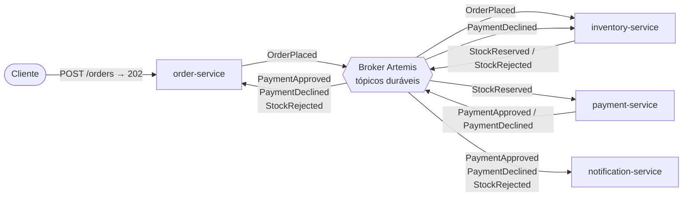

# Event-Driven Architecture — Processamento de pedidos online

Implementação de referência do estilo **orientado a eventos** (*event-driven architecture*), na **topologia de broker**
(*broker topology*) descrita no livro *Fundamentos da Arquitetura de Software* (Richards & Ford), em **Java 21,
Spring Boot e ActiveMQ Artemis** (broker JMS).

## O problema

Uma loja online precisa, a cada pedido, reservar estoque, cobrar o cliente e avisá-lo. Com chamadas síncronas em
cadeia (pedido → estoque → pagamento → e-mail), qualquer serviço lento ou fora do ar derruba o checkout, e cada
funcionalidade nova (antifraude, pontos de fidelidade, analytics) obriga a mexer no serviço de pedidos. Aqui o
processamento é um **fluxo de eventos**: cada serviço reage a algo que aconteceu e anuncia o que fez, sem conhecer
quem vem depois.

## A ideia em um parágrafo

Serviços (*event processors*) são **desacoplados e assíncronos**: nenhum chama outro. Quando algo relevante acontece,
o serviço **publica um evento** no *broker* (`OrderPlaced`, `StockReserved`, `PaymentApproved`…) e segue em frente.
Quem se interessa **assina** o tópico e reage, publicando novos eventos. Não há orquestrador central: o fluxo
**emerge** da cadeia de reações. Falhas parciais (um serviço fora do ar) não perdem nada: o broker guarda os eventos
até o consumidor voltar.



## Documentação

| Documento | Conteúdo |
|-----------|----------|
| [01 — Conceito](docs/01-conceito.md) | Broker vs. mediator, event processors, eventos vs. mensagens, assíncrono, durabilidade |
| [02 — Quando usar](docs/02-quando-usar.md) | Critérios de decisão, bons e maus casos de uso, comparação com outros estilos |
| [03 — Arquitetura da implementação](docs/03-arquitetura-da-implementacao.md) | Mapeamento livro → código, sequências (sucesso, recusa, falha), tópicos, API |
| [04 — Decisões e trade-offs](docs/04-decisoes-e-tradeoffs.md) | Escolhas de design, idempotência, riscos conhecidos e como evoluir |
| [05 — Características e testes](docs/05-caracteristicas-e-testes.md) | Avaliação das características de arquitetura e como validar cada uma |

## Estrutura

```
event-driven-architecture/
├── event-contracts/        # os eventos (records) + wiring JMS: o ÚNICO código compartilhado entre serviços
├── order-service/          # recebe o pedido (202), publica OrderPlaced, reage ao desfecho (:8091)
├── inventory-service/      # reserva estoque; devolve se o pagamento for recusado (compensação) (:8092)
├── payment-service/        # cobra após a reserva; aprova até um limite (:8093)
├── notification-service/   # assinante puro: avisa o cliente; acrescentado sem tocar nos outros (:8094)
├── e2e-tests/              # broker Artemis embutido + os 4 serviços, cada um em seu contexto Spring
├── Dockerfile · docker-compose.yml
└── docs/
```

## Como executar

Pré-requisitos: JDK 21+, Maven 3.9+ (Docker opcional).

```bash
# testes: sobem um broker Artemis real (TCP) e os 4 serviços na mesma JVM — não precisa de Docker
mvn verify

# topologia completa: broker + 4 serviços
docker compose up -d --build
```

```bash
# estoque inicial do compose: console=5, phone=100
curl -s -X POST localhost:8091/orders -H 'Content-Type: application/json' \
  -d '{"customerId":"ana","sku":"console","quantity":1,"unitPriceCents":300000}'
# -> 202 {"id":"...","status":"PENDING",...}   (o pedido foi ACEITO; o desfecho vem depois)

curl -s localhost:8091/orders/<id>                 # CONFIRMED (ou CANCELLED, com o motivo)
curl -s localhost:8092/stock/console               # 4
curl -s "localhost:8094/notifications?customerId=ana"
```

### API

| Serviço | Método | Rota | Descrição |
|---------|--------|------|-----------|
| order | `POST` | `/orders` | `{"customerId","sku","quantity"(1-10),"unitPriceCents"}` → `202` + pedido `PENDING` |
| order | `GET` | `/orders/{id}` | Estado atual: `PENDING` · `CONFIRMED` · `CANCELLED` (+ `reason`) |
| inventory | `GET`/`PUT` | `/stock/{sku}` | Consulta / define o estoque (`{"quantity":n}`) |
| payment | `GET` | `/payments/{orderId}` | Decisão de pagamento do pedido |
| notification | `GET` | `/notifications?customerId=` | Mensagens enviadas ao cliente |

Regras de demonstração: pagamento **recusado acima de 1.000.000 centavos** (`payment.limit-cents`); `quantity` > estoque
cancela o pedido.

### Experimentos sugeridos

```bash
# 1. Derrube o pagamento: pedidos ficam PENDING, nada se perde; ao voltar, são todos confirmados
docker compose stop payment-service
curl -s -X POST localhost:8091/orders -H 'Content-Type: application/json' \
  -d '{"customerId":"bia","sku":"phone","quantity":1,"unitPriceCents":90000}'
docker compose start payment-service

# 2. Recusa de pagamento: o estoque reservado é devolvido por compensação (veja /stock/console antes e depois)
curl -s -X POST localhost:8091/orders -H 'Content-Type: application/json' \
  -d '{"customerId":"caio","sku":"console","quantity":1,"unitPriceCents":2000000}'

# 3. Console do broker: http://localhost:8161 (artemis / artemis) — veja as filas/assinaturas duráveis
```

## Limitações (resumo)

Implementação **didática**; atalhos conscientes em [04 — Decisões e trade-offs](docs/04-decisoes-e-tradeoffs.md):
estado em memória (sem banco por serviço), sem *outbox* (publicar após mudar o estado não é atômico), sem DLQ/retry
configurados, sem *event sourcing* e sem *schema registry*. O `docker-compose.yml` **não foi executado** no ambiente de
desenvolvimento (sem Docker); o comportamento é validado pelos testes com broker embutido.
