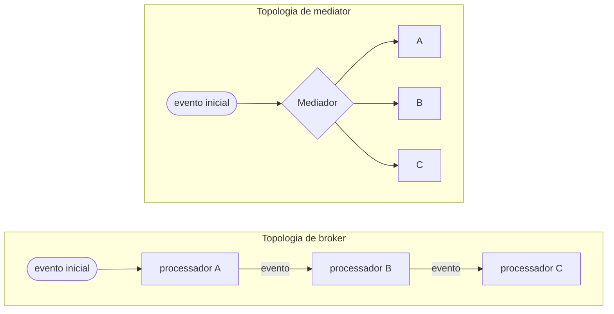

# 01 — Conceito

## O que é

Na arquitetura **orientada a eventos** o sistema é um conjunto de **processadores de eventos** (*event processors*)
**altamente desacoplados** que se comunicam de forma **assíncrona** por meio de um canal. Um evento é o registro de
**algo que já aconteceu** (`OrderPlaced`, `PaymentApproved`) — não um pedido para alguém fazer algo. O produtor
publica e segue; os consumidores decidem se e como reagir.

O livro descreve duas topologias:

| | **Broker** (esta implementação) | **Mediator** |
|-|-------------------------------|--------------|
| Quem conduz o fluxo | Ninguém: cada processador reage e publica o próximo evento (**coreografia**) | Um **mediador** central recebe o evento inicial e orquestra os passos |
| Acoplamento | Mínimo; nenhum serviço conhece os outros | Processadores conhecem o contrato do mediador |
| Tratamento de erro / fluxo complexo | Difícil: o fluxo está espalhado | Mais fácil: está num lugar só |
| Desempenho, elasticidade | Altos | Menores (o mediador é gargalo) |
| Bom para | Fluxos simples, alta reatividade | Fluxos com muitos passos e regras de negócio / reparo |

## Componentes (broker topology)

| Componente do livro | Nesta implementação |
|---------------------|---------------------|
| **Evento inicial** (*initiating event*) | `OrderPlaced`, disparado pelo `POST /orders` |
| **Canal de eventos** (*event channel*) | Tópicos do ActiveMQ Artemis (publish/subscribe), um por tipo de evento |
| **Event broker** | O próprio Artemis (um único cluster de mensageria) |
| **Processador de eventos** (*event processor*) | `order`, `inventory`, `payment`, `notification` |
| **Evento derivado** (*processing event*) | `StockReserved`, `PaymentApproved`… publicados em reação a outro evento |

## Ideias-chave

- **Evento ≠ comando.** `OrderPlaced` (fato, vários interessados possíveis) em vez de `ReserveStock` (ordem para um
  destinatário). É o que permite adicionar assinantes sem alterar o produtor.
- **Fire-and-forget.** O produtor não espera resposta. Por isso o `POST /orders` responde **202** (aceito), não 201:
  o desfecho é decidido depois, e o cliente consulta (*polling*) ou recebe uma notificação.
- **Durabilidade.** Assinaturas duráveis fazem o broker **reter** os eventos de um consumidor que está fora do ar.
- **Consistência eventual.** Não há transação ACID atravessando serviços. Quando um passo falha, os outros
  **compensam** com novos eventos (ex.: pagamento recusado → estoque devolvido).
- **Idempotência.** Mensageria entrega *pelo menos uma vez*; consumidores precisam tolerar o mesmo evento duas vezes.
- **Contrato compartilhado = os eventos.** É o único acoplamento (módulo `event-contracts`).
