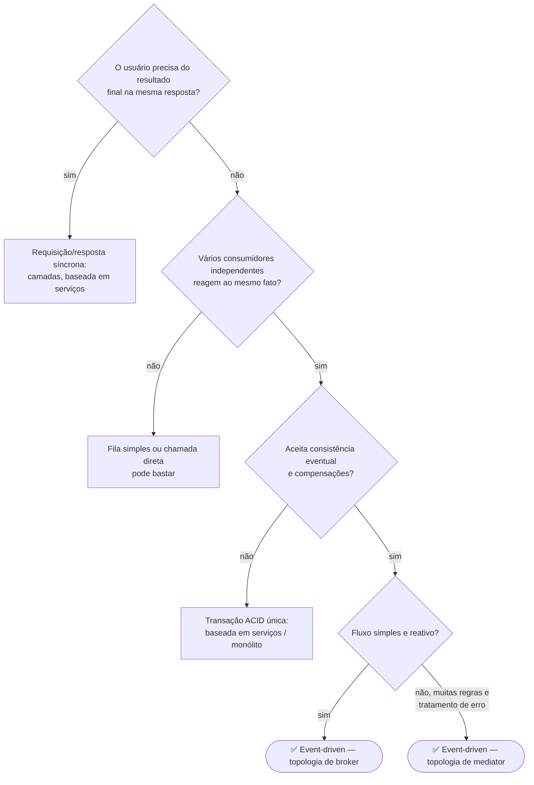

# 02 — Quando usar (e quando não usar)

## Resumo da decisão

Use arquitetura orientada a eventos quando o processamento é **assíncrono por natureza**, quando **desacoplamento,
reatividade e extensibilidade** importam mais que a **simplicidade e a consistência imediata**, e quando a equipe
aceita testar e operar um sistema **distribuído e eventualmente consistente**.

## Sinais de que o estilo é adequado

- Fluxos de negócio **assíncronos**: pedidos, logística, onboarding, notificações, pipelines de dados em tempo real.
- **Muitos interessados** no mesmo fato (estoque, cobrança, e-mail, analytics, antifraude) e a lista **cresce**.
- Precisa **absorver picos** e **tolerar falhas parciais** sem derrubar quem origina o evento.
- Serviços de **equipes diferentes** evoluindo e implantando de forma independente.
- Alta **responsividade**: o produtor não espera ninguém.

| Domínio | Por que encaixa |
|---------|-----------------|
| E-commerce (pedido → estoque → pagamento → entrega) | Passos independentes, vários assinantes, picos sazonais |
| IoT / telemetria | Fluxo contínuo de fatos; muitos consumidores |
| Notificações e integrações | Fan-out natural a partir de um fato |
| Detecção de fraude em tempo real | Novo consumidor sem tocar no sistema transacional |

### Por que **processamento de pedidos** foi o caso escolhido

1. O fluxo tem **passos com donos distintos** (estoque, pagamento) e um **assinante periférico** (notificação) que
   mostra a extensibilidade na prática.
2. Tem **caminho feliz e dois caminhos de falha** (sem estoque, pagamento recusado) — exige **compensação**.
3. Permite testar com objetivos claros: **nenhuma venda a mais** com pedidos concorrentes e **nenhuma perda** quando
   um serviço cai.

## Quando **não** usar

| Situação | Por quê |
|----------|---------|
| Precisa de **resultado imediato e transação atômica** entre vários dados | Não há ACID entre serviços; cada passo é eventualmente consistente |
| Fluxo **simples e síncrono** (CRUD) | Broker, tópicos e idempotência são custo sem retorno |
| **Fluxos de negócio complexos com muita lógica de erro** na topologia de broker | Ninguém enxerga o fluxo inteiro; use *mediator* ou *orquestração* |
| Equipe sem prática em **depuração distribuída** | Rastrear um pedido por vários serviços e tópicos é difícil sem *tracing* |
| Exige **ordem global estrita** de eventos | Ordem só é garantida por fila/partição, não entre tópicos |

## Comparação rápida

| Estilo | Comunicação | Consistência | Acoplamento | Complexidade operacional |
|--------|-------------|--------------|-------------|--------------------------|
| Em camadas | Chamada em memória | ACID | Alto (camadas) | Baixa |
| Baseada em serviços | Síncrona via gateway | ACID (banco único) | Médio | Média |
| **Orientada a eventos** | **Assíncrona via broker** | **Eventual** | **Mínimo** | **Alta** |
| Microsserviços | Mistura sync/async | Eventual | Baixo (dados isolados) | Muito alta |
