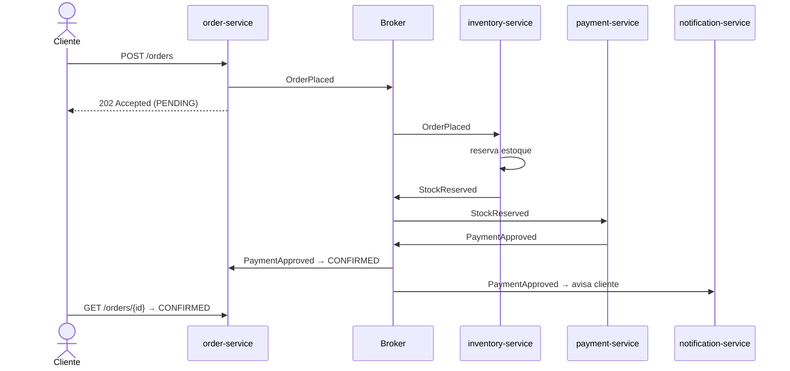
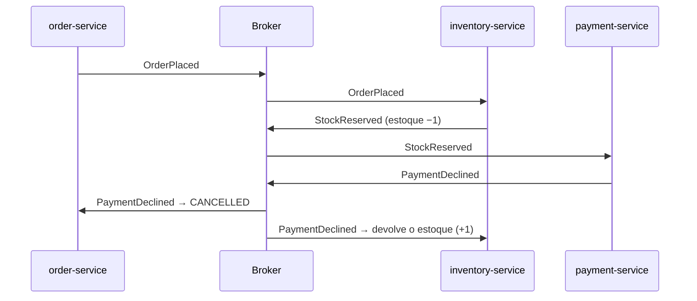
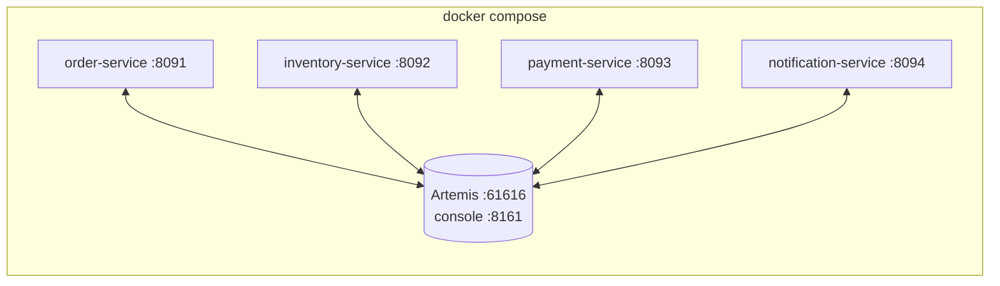

# 03 — Arquitetura da implementação

## Mapeamento livro → código

| Conceito | Onde |
|----------|------|
| Eventos (contrato) | [`Events`](../event-contracts/src/main/java/com/github/diovanibmotta/eventdriven/contracts/Events.java): 5 `record`s + nome do tópico de cada um |
| Publicar um evento | [`EventPublisher`](../event-contracts/src/main/java/com/github/diovanibmotta/eventdriven/contracts/EventPublisher.java) (`JmsTemplate` em modo pub/sub) |
| Canal + assinatura durável compartilhada | [`MessagingConfig`](../event-contracts/src/main/java/com/github/diovanibmotta/eventdriven/contracts/MessagingConfig.java) |
| Evento inicial | `OrderService.place` publica `OrderPlaced` |
| Processadores | `OrderService`, `InventoryService`, `PaymentService`, `NotificationService` (`@JmsListener`) |
| Compensação | `InventoryService.on(PaymentDeclined)` devolve o estoque |
| Assinante puro | `NotificationService`: ninguém depende dele |

## Tópicos e quem assina

| Tópico | Publicado por | Assinado por (nome da assinatura) |
|--------|---------------|-----------------------------------|
| `orders.placed` | order | inventory (`inventory-order-placed`) |
| `inventory.stock-reserved` | inventory | payment (`payment-stock-reserved`) |
| `inventory.stock-rejected` | inventory | order, notification |
| `payments.approved` | payment | order, notification |
| `payments.declined` | payment | order, notification, **inventory** (compensação) |

Cada par *(serviço, tópico)* tem **uma assinatura durável e compartilhada** com nome próprio. *Durável*: o broker retém
eventos de quem está offline. *Compartilhada*: várias instâncias do mesmo serviço **competem** pelas mensagens (escala
horizontal sem processar duas vezes). Dois serviços diferentes no mesmo tópico recebem **cada um sua cópia**.

## Fluxos

### Caminho feliz

### Pagamento recusado (compensação)

Não existe `ROLLBACK`: o **desfazer** é um evento tratado por quem fez o efeito. Falta de estoque é mais simples:
`StockRejected` cancela o pedido e nada precisa ser desfeito.

### Um serviço fora do ar

Se `payment-service` cair, `StockReserved` fica retido na assinatura `payment-stock-reserved`. O pedido continua
`PENDING`; ao voltar, o serviço consome o backlog e o pedido é confirmado. Order e inventory nunca perceberam a falha.

## Topologia de execução

Cada serviço lê seu endereço do broker de variáveis de ambiente do Spring (`SPRING_ARTEMIS_BROKER_URL` etc.): não há
`application.yml`, o que também permite subir os quatro no mesmo *classpath* de testes.
