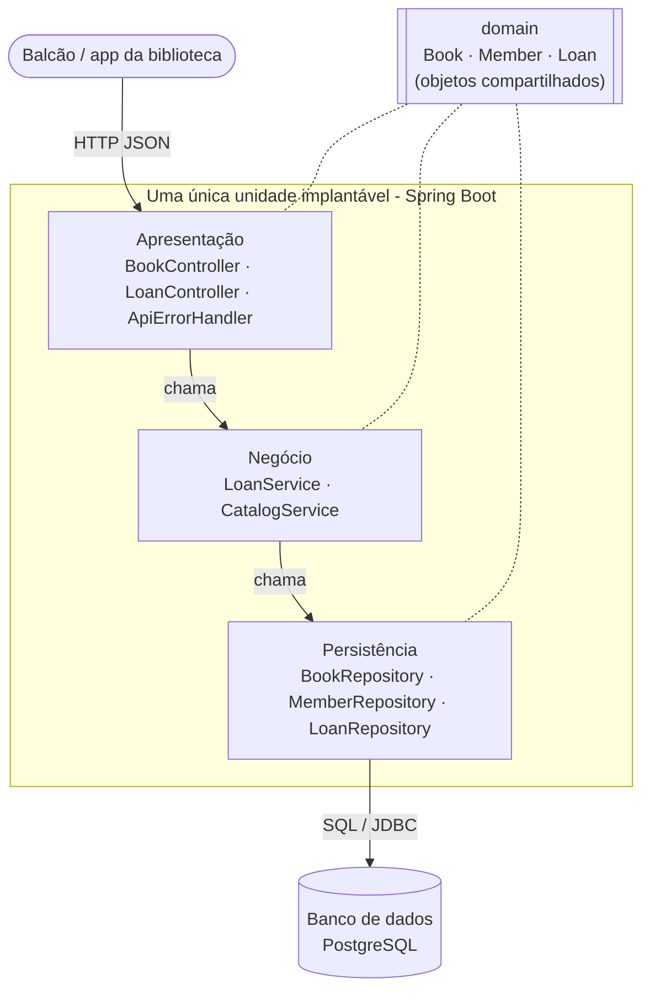

# Layered Architecture — Empréstimos de uma biblioteca comunitária

Implementação de referência do estilo **arquitetura em camadas** (*layered* ou *n-tier*) do livro
*Fundamentos da Arquitetura de Software* (Richards & Ford), usando **Java 21, Spring Boot, Spring JDBC e PostgreSQL**.

## O problema

Uma biblioteca comunitária quer sair da planilha. Precisa de um sistema simples para **catálogo de livros, empréstimos
e devoluções**, com poucas regras de negócio — mas regras que não podem falhar:

- cada membro pode ter no máximo **3 livros** emprestados ao mesmo tempo;
- quem tem **empréstimo vencido** não pega livro novo até devolver;
- prazo de **14 dias**, multa de **R$ 2,00 por dia** de atraso;
- **nunca** emprestar mais exemplares do que a biblioteca possui (dois balcões podem tentar emprestar o último exemplar no mesmo segundo).

Orçamento curto, equipe pequena (dois voluntários que sabem Spring), dezenas de usuários, um banco relacional. É o
cenário típico em que o livro recomenda começar pela arquitetura em camadas: **simples, barata, conhecida por todos**.

## A ideia em um parágrafo

O sistema é dividido **por papel técnico**: cada camada tem uma única responsabilidade e só conversa com a camada
imediatamente abaixo. A **apresentação** entende HTTP; o **negócio** entende empréstimos; a **persistência** entende SQL;
o **banco** guarda os dados. As camadas são **fechadas**: uma requisição não pode pular a camada de negócio e ir direto
ao repositório — e isso é **verificado por teste** (ArchUnit), não só combinado em wiki.



## Documentação

| Documento | Conteúdo |
|-----------|----------|
| [01 — Conceito](docs/01-conceito.md) | Camadas, separação de responsabilidades, camadas fechadas × abertas, *layers of isolation*, topologias, *architecture sinkhole* |
| [02 — Quando usar](docs/02-quando-usar.md) | Critérios de decisão, bons e maus casos de uso, comparação com outros estilos |
| [03 — Arquitetura da implementação](docs/03-arquitetura-da-implementacao.md) | Mapeamento livro → código, diagramas de sequência, modelo de dados, API |
| [04 — Decisões e trade-offs](docs/04-decisoes-e-tradeoffs.md) | Escolhas de design, concorrência, limitações conhecidas e como evoluir |
| [05 — Características e testes](docs/05-caracteristicas-e-testes.md) | Avaliação das características de arquitetura e como validar cada uma |

## Estrutura

```
layered-architecture/
├── src/main/java/com/github/diovanibmotta/layered/
│   ├── presentation/     # camada de apresentação: controllers REST, DTOs de entrada/saída, erros → HTTP
│   ├── business/         # camada de negócio: regras de empréstimo, devolução, multa, disponibilidade
│   ├── persistence/      # camada de persistência: repositórios com SQL explícito (JdbcClient)
│   └── domain/           # objetos de domínio compartilhados (Book, Member, Loan) — não é uma camada
├── src/main/resources/
│   ├── schema.sql        # camada de banco de dados: tabelas e índices
│   └── data.sql          # carga inicial (catálogo e membros)
├── src/test/java/...     # LayeredArchitectureTest (regras das camadas) + LibraryApiTest (ponta a ponta)
├── Dockerfile
├── docker-compose.yml    # aplicação + PostgreSQL
└── docs/
```

## Como executar

Pré-requisitos: JDK 21+, Maven 3.9+ e, opcionalmente, Docker.

```bash
# testes: regras de camadas (ArchUnit) + API ponta a ponta + concorrência no último exemplar
mvn verify

# rodar local com H2 em memória (porta 8080)
mvn spring-boot:run

# ou a topologia "real": aplicação + PostgreSQL (porta 8081, para conviver com o space-based na 8080)
docker compose up -d --build
```

### Roteiro rápido

```bash
API=http://localhost:8081   # ou 8080 se estiver usando mvn spring-boot:run

curl -s $API/books                                   # catálogo com exemplares disponíveis
curl -s -X POST $API/loans -H 'Content-Type: application/json' \
     -d '{"isbn":"978-8550804606","memberId":"ana"}'  # 201: Ana leva o único exemplar
curl -s -X POST $API/loans -H 'Content-Type: application/json' \
     -d '{"isbn":"978-8550804606","memberId":"bruno"}' # 409 NO_COPIES_AVAILABLE
curl -s -X POST $API/loans/1/return                   # 200 com fineCents
curl -s $API/members/ana/loans                        # histórico da Ana
```

### API

| Método | Rota | Descrição |
|--------|------|-----------|
| `GET` | `/books` | Catálogo com `totalCopies` e `availableCopies` |
| `GET` | `/books/{isbn}` | Um livro. `404 BOOK_NOT_FOUND` |
| `POST` | `/loans` | Corpo `{"isbn":"...","memberId":"..."}`. `201` emprestado · `404 BOOK_NOT_FOUND`/`MEMBER_NOT_FOUND` · `409 NO_COPIES_AVAILABLE`/`LOAN_LIMIT_REACHED`/`HAS_OVERDUE_LOANS` · `400` corpo inválido |
| `POST` | `/loans/{id}/return` | Devolve e calcula a multa (`fineCents`). `409 ALREADY_RETURNED` · `404 LOAN_NOT_FOUND` |
| `GET` | `/members/{id}/loans` | Histórico de empréstimos do membro. `404 MEMBER_NOT_FOUND` |

Membros pré-cadastrados: `ana`, `bruno`, `carla`.

### Experimentos sugeridos

1. **Quebre uma camada fechada**: injete `BookRepository` no `BookController` e rode `mvn verify` — o
   `LayeredArchitectureTest` falha apontando a violação.
2. **Remova o `FOR UPDATE`** de `BookRepository#findByIsbnForUpdate` e rode os testes — o teste de concorrência
   empresta mais exemplares do que existem.
3. **Sinta o custo da mudança**: adicione "editora" ao livro. Repare quantas camadas você precisa tocar
   (schema → `Book` → repositório → `BookView`). Esse é o principal trade-off do particionamento técnico
   ([04 — Decisões e trade-offs](docs/04-decisoes-e-tradeoffs.md)).

## Limitações (resumo)

É uma implementação **didática**: sem autenticação, sem cadastro de livros/membros via API (só carga inicial), sem
paginação e sem migração versionada de schema (`schema.sql` idempotente no lugar de Flyway). Detalhes e como evoluir em
[04 — Decisões e trade-offs](docs/04-decisoes-e-tradeoffs.md).
