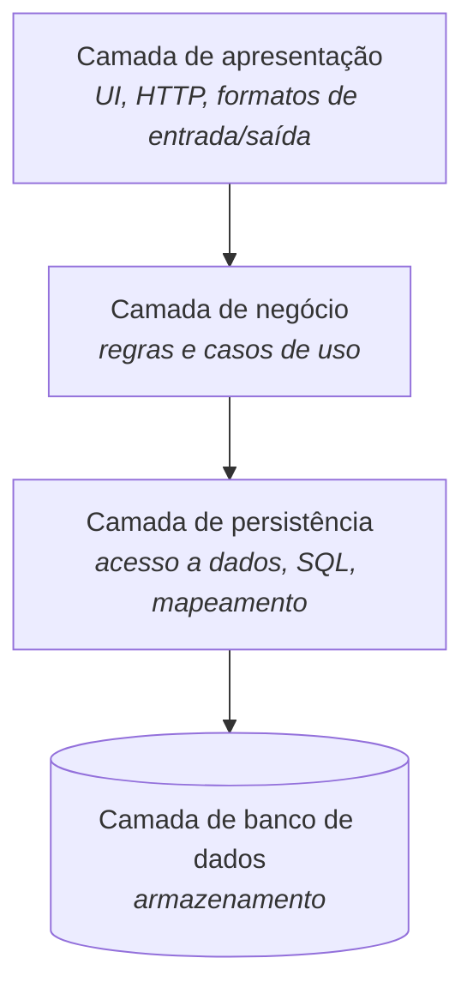
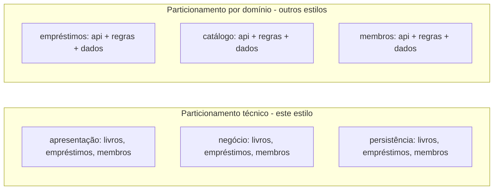
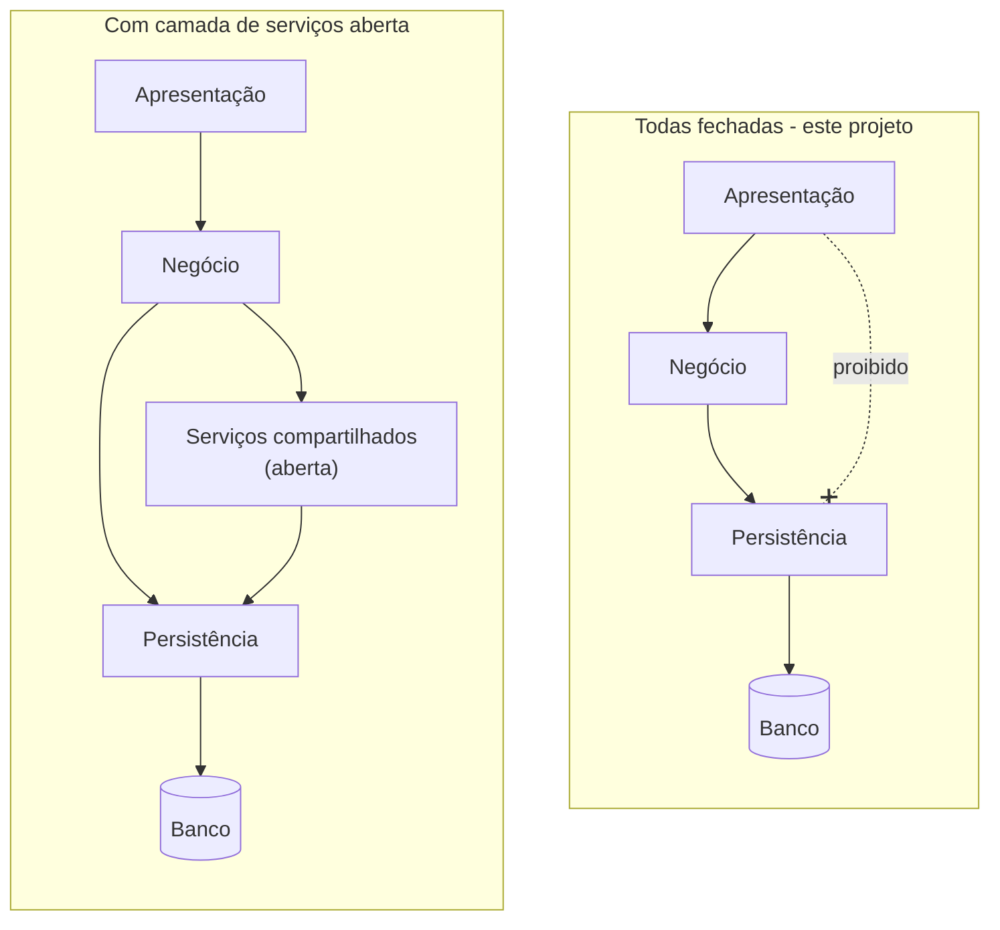
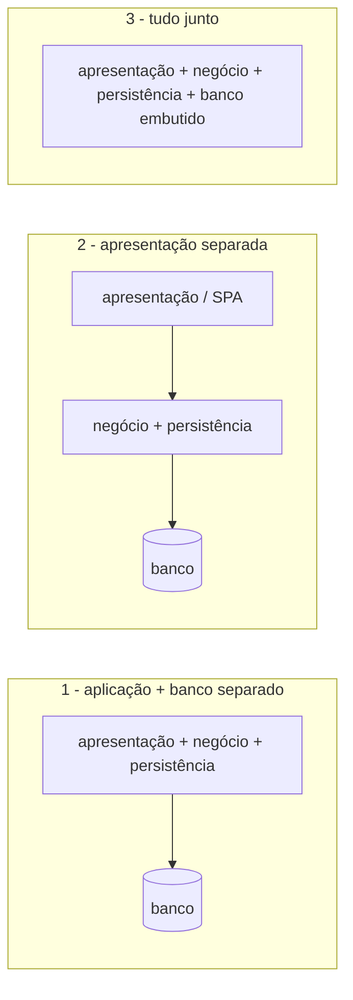

# 01 — Conceito: arquitetura em camadas

A arquitetura em camadas (*layered*, também chamada *n-tier*) é o estilo mais comum e, muitas vezes, o **padrão de fato**
— é o que surge quando ninguém escolhe um estilo. Ela organiza o código em **camadas horizontais**, cada uma com um papel
técnico específico. O livro a classifica como uma arquitetura **monolítica** e **particionada tecnicamente**.

## Componentes

A topologia clássica tem quatro camadas:

| Camada | Responsabilidade | Não deve saber |
|--------|------------------|----------------|
| **Apresentação** | Receber requisições, validar formato, traduzir resultados para a interface (HTTP, telas) | Como as regras funcionam, como os dados são guardados |
| **Negócio** | Aplicar as regras do domínio e coordenar o caso de uso | Que existe HTTP; qual SQL é executado |
| **Persistência** | Ler e gravar dados; traduzir linhas em objetos | Por que os dados estão sendo lidos ou gravados |
| **Banco de dados** | Armazenar os dados de forma durável e consistente | Nada sobre a aplicação |

### Separação de responsabilidades

Cada camada forma uma **abstração** em torno do trabalho que precisa ser feito para atender a uma requisição. A camada
de apresentação não precisa saber *como* obter os dados de um cliente; só precisa exibi-los em determinado formato. Essa
separação torna fácil montar **papéis e responsabilidades** claros no time (desenvolvedores de UI, backend, DBA) — o que
explica boa parte da popularidade do estilo (a *Lei de Conway* em ação: a arquitetura espelha a organização em times
técnicos).

### Particionamento técnico

Os componentes são agrupados pelo **papel técnico** (apresentação, negócio, persistência), não pelo **domínio**
(empréstimo, catálogo, membros). A consequência:

Um conceito de domínio ("empréstimo") fica **espalhado por todas as camadas**. Adicionar um campo ao empréstimo toca
apresentação, negócio, persistência e banco — veja o experimento 3 no [README](../README.md).

## Camadas fechadas e abertas

Uma camada **fechada** (*closed*) obriga a requisição a passar por ela: a apresentação não pode chamar a persistência
diretamente, precisa passar pelo negócio. Uma camada **aberta** (*open*) pode ser pulada.

Por que fechar? Pelo conceito de **camadas de isolamento** (*layers of isolation*): mudanças em uma camada não afetam as
outras, **desde que os contratos se mantenham**. Se a apresentação acessasse o SQL diretamente, trocar o banco ou mudar uma
tabela exigiria mexer na apresentação também — o acoplamento vazaria entre camadas.

Camadas abertas aparecem quando faz sentido adicionar uma camada **de serviços compartilhados** (utilitários de auditoria,
formatação, logging de negócio) que a camada de negócio pode usar *ou não*. O livro recomenda **documentar
explicitamente** quais camadas são abertas e quais são fechadas — e, de preferência, **automatizar a verificação** (é o que
o `LayeredArchitectureTest` faz aqui, com ArchUnit). Sem governança, o estilo degrada com o tempo para uma "grande bola
de lama".

## Topologias de implantação

As camadas são uma divisão **lógica**; fisicamente, podem ser implantadas de formas diferentes:

Este projeto usa a **topologia 1** (`docker-compose`: uma aplicação Spring Boot + PostgreSQL). Rodando com
`mvn spring-boot:run`, usa a **topologia 3** (H2 embutido em memória). O código não muda entre as duas — exatamente o
benefício do isolamento da camada de persistência.

Em qualquer variante, o estilo continua com **um único quantum de arquitetura**: tudo é implantado junto e depende de um
único banco.

## Antipadrão: *architecture sinkhole*

O "sumidouro" acontece quando requisições **atravessam as camadas sem que nenhuma lógica seja aplicada** — o negócio só
repassa a chamada da apresentação para a persistência e devolve o resultado.

Neste projeto, `GET /members/{id}/loans` é praticamente um sumidouro: `LoanService#loansOf` só verifica se o membro existe
e repassa a consulta. Isso **é aceitável** em pequena proporção. O livro sugere a **regra 80-20**: se ~20% das requisições
forem sumidouros, tudo bem; se 80% forem, a arquitetura em camadas provavelmente não é o estilo certo para o problema
(ou algumas camadas deveriam ser abertas).

| Rota | Lógica de negócio aplicada | Sumidouro? |
|------|----------------------------|:----------:|
| `POST /loans` | limite, atraso, disponibilidade, prazo, travas | não |
| `POST /loans/{id}/return` | multa, devolução duplicada | não |
| `GET /books`, `GET /books/{isbn}` | cálculo de exemplares disponíveis | não |
| `GET /members/{id}/loans` | só existência do membro | quase |

## Resumo

| Aspecto | Arquitetura em camadas |
|---------|------------------------|
| Tipo | Monolítica |
| Particionamento | Técnico |
| Quanta de arquitetura | 1 |
| Ponto forte | Simplicidade, custo, familiaridade |
| Ponto fraco | Escalabilidade, elasticidade, implantabilidade, evolução de domínio |
