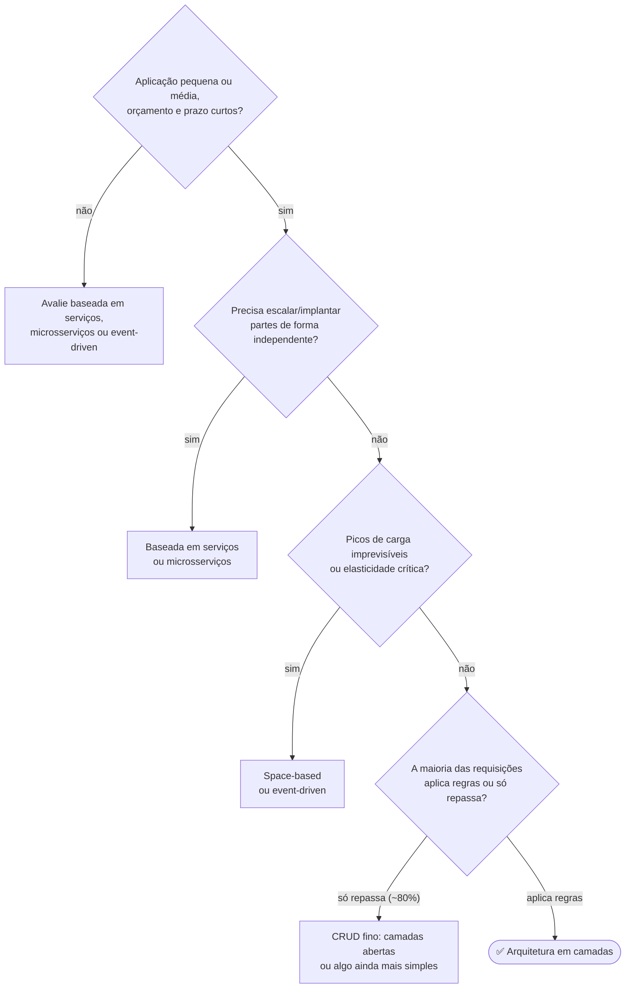

# 02 — Quando usar (e quando não usar)

## Resumo da decisão

Use arquitetura em camadas quando **simplicidade, custo baixo e velocidade de entrega** pesam mais do que escalabilidade,
elasticidade ou implantação independente. É um ótimo **ponto de partida** quando ainda não se sabe qual estilo o sistema
vai precisar — desde que se mantenha a disciplina para poder migrar depois.

## Sinais de que o estilo é adequado

- **Aplicação pequena ou de complexidade moderada**, com um único banco relacional.
- **Orçamento e prazo apertados**; time pequeno ou acostumado a frameworks MVC (Spring, Rails, Django, ASP.NET).
- **Requisitos ainda incertos** — começar simples e evoluir quando as necessidades aparecerem.
- Carga **previsível e moderada**; escalar verticalmente (ou com algumas réplicas atrás de um balanceador) basta.
- Mudanças são feitas **por camada** com mais frequência do que **por domínio** (ex.: trocar banco, trocar UI).
- Time organizado por **especialidade técnica** (front, back, DBA).

### Exemplos típicos

| Domínio | Por que encaixa |
|---------|-----------------|
| Sistemas internos/administrativos (biblioteca, clínica pequena, ONG) | Poucos usuários, regras simples, orçamento curto |
| Back-office e CRUDs com regras de validação | Fluxo requisição → regra → banco é natural |
| MVPs e provas de conceito | Velocidade de entrega; todo desenvolvedor conhece o padrão |
| Aplicações departamentais | Um time, um banco, implantação rara |

## Sinais de que o estilo **não** é adequado

| Sinal | Por quê | Estilo melhor |
|-------|---------|---------------|
| Partes do sistema com cargas muito diferentes | Tudo escala junto: não dá para escalar só "empréstimos" | Baseada em serviços, microsserviços |
| Times diferentes por domínio, entregando de forma independente | Toda mudança atravessa todas as camadas e exige implantar tudo | Microsserviços, modular monolith |
| Picos explosivos de usuários | Banco único no caminho crítico vira gargalo | Space-based |
| Muitos fluxos assíncronos e reações a eventos | O estilo é síncrono por natureza (requisição → resposta) | Event-driven |
| Sistema grande e de vida longa | Tende a virar "grande bola de lama" sem governança forte | Modular, baseada em serviços |
| Alta disponibilidade com implantações frequentes | Toda implantação é do monólito inteiro | Microsserviços |

## Comparação com os demais estilos do laboratório

| Critério | Em camadas | Space-based ([exemplo](../../space-based-architecture)) |
|----------|-----------|-------------|
| Particionamento | Técnico | Domínio (unidades de processamento) |
| Caminho crítico | Banco no meio de toda requisição | Banco fora do caminho (grid em memória) |
| Consistência | Forte (transação ACID) | Eventual entre grid e banco |
| Concorrência no "último item" | `SELECT ... FOR UPDATE` no banco | Operação atômica no grid |
| Custo | $ | $$$$ |
| Simplicidade | ★★★★★ | ★ |
| Elasticidade | ★ | ★★★★★ |

Os dois exemplos têm a **mesma regra de fundo** — "nunca entregar o mesmo recurso duas vezes" — resolvida de formas
opostas: aqui, deixando o **banco relacional** serializar o acesso; lá, tirando o banco do caminho. Se a biblioteca
precisasse atender a 50 mil pedidos por segundo no lançamento de um best-seller, a resposta mudaria.

## Estratégia de evolução

O livro lembra que o estilo é um bom começo **se** a separação for mantida. Quando a aplicação crescer:

1. Organize **subpacotes por domínio dentro de cada camada** (`business.loans`, `business.catalog`) — prepara a extração.
2. Evolua para um **monólito modular** (particionamento por domínio dentro de um único deployable).
3. Extraia domínios com necessidades diferentes para **serviços** (baseada em serviços → microsserviços).
