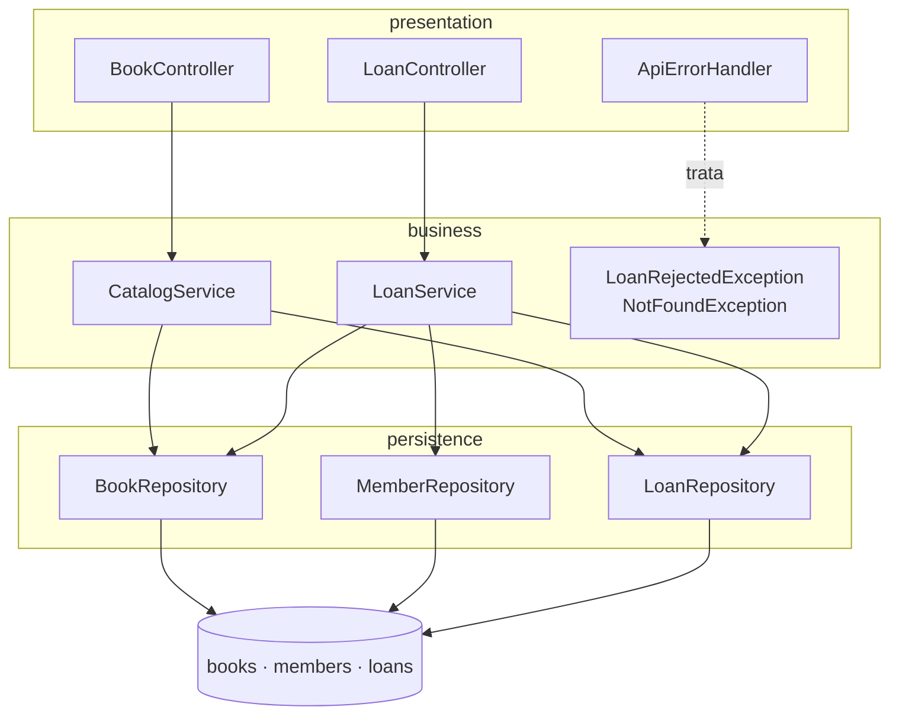
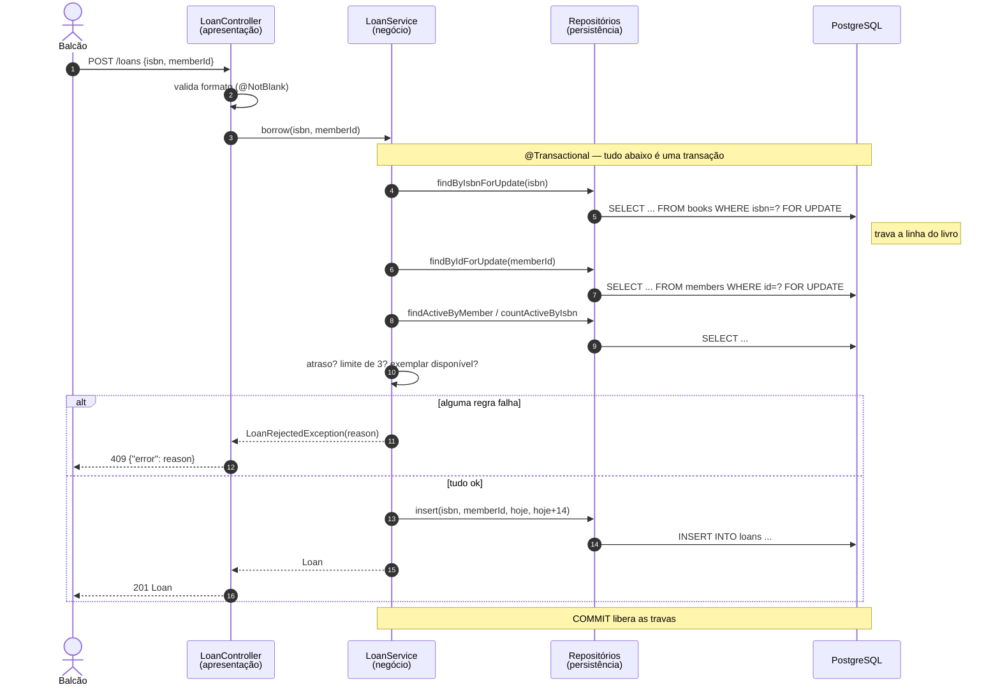
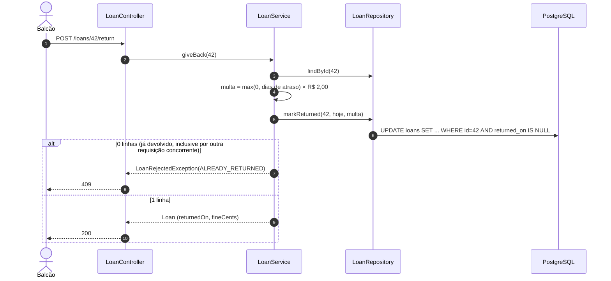
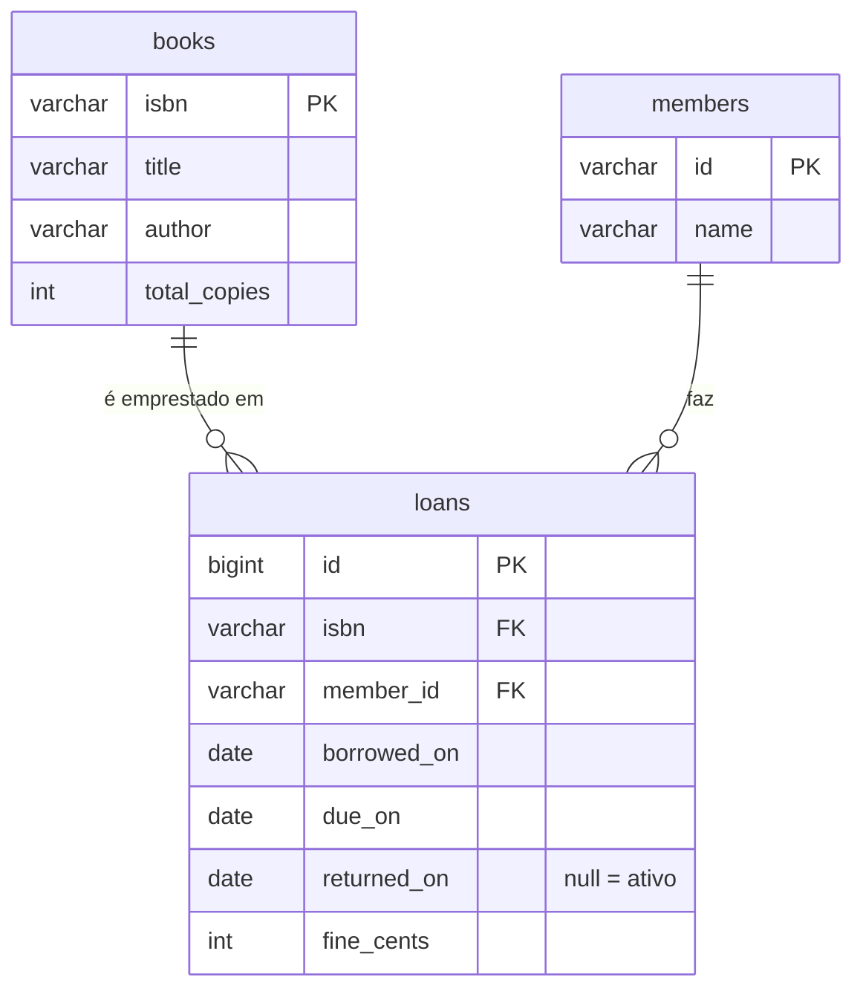
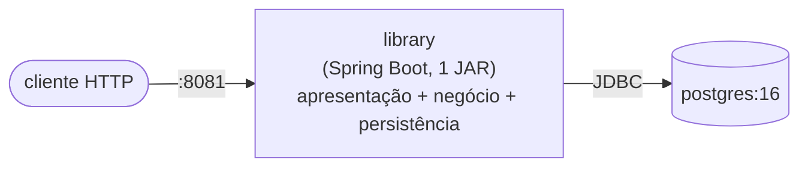

# 03 — Arquitetura da implementação

## Mapeamento livro → código

| Conceito do livro | Implementação | Onde |
|-------------------|---------------|------|
| Camada de apresentação | Controllers REST, DTOs (`BookView`, `BorrowRequest`), tradução de exceções em status HTTP | `presentation/` |
| Camada de negócio | `LoanService` (empréstimo, devolução, multa) e `CatalogService` (disponibilidade) | `business/` |
| Camada de persistência | Repositórios com SQL explícito via `JdbcClient` | `persistence/` |
| Camada de banco de dados | PostgreSQL (compose) ou H2 em modo PostgreSQL (local/testes) | `schema.sql`, `data.sql` |
| Camadas fechadas | Regras ArchUnit que quebram o build em caso de violação | `LayeredArchitectureTest` |
| Objetos compartilhados entre camadas | Records `Book`, `Member`, `Loan` sem dependência de nenhuma camada | `domain/` |
| Unidade de implantação única | Um JAR Spring Boot | `Dockerfile` |

## Visão de componentes

Repare no que **não** existe: nenhuma seta da apresentação para a persistência, nenhuma seta de baixo para cima. As
exceções de negócio são da camada de negócio; quem decide que `LoanRejectedException` vira `409` é a apresentação
(`ApiErrorHandler`). A camada de negócio nunca importa nada de `org.springframework.web` ou `org.springframework.http`
— também verificado por teste.

## Fluxo: emprestar um livro

### Por que as travas?

Sem elas, dois balcões que tentam emprestar o **último exemplar** ao mesmo tempo leem "1 disponível" em paralelo e ambos
gravam o empréstimo. O `SELECT ... FOR UPDATE` na linha do livro faz a segunda transação **esperar** a primeira
terminar; quando ela lê de novo, o exemplar já foi emprestado. A trava na linha do membro faz o mesmo para o limite de
3 livros (o mesmo membro em dois balcões). A ordem é sempre **livro → membro**, então não há ciclo de espera (deadlock).

Esse controle está **dividido entre as camadas** do jeito que o estilo pede: a camada de negócio decide *que* precisa de
exclusividade (é uma regra: "não emprestar o mesmo exemplar duas vezes"); a camada de persistência decide *como*
(`FOR UPDATE`).

## Fluxo: devolver um livro

A devolução não precisa de trava explícita: o `UPDATE ... WHERE returned_on IS NULL` é uma **escrita condicional** —
se duas devoluções concorrem, só uma altera a linha.

## Modelo de dados

Exemplares disponíveis **não são armazenados**: são calculados (`total_copies − empréstimos ativos`). Assim não há
contador para ficar inconsistente — a fonte da verdade é a tabela `loans`.

## Topologia de implantação

| Ambiente | Banco | Como |
|----------|-------|------|
| Local | H2 em memória (modo PostgreSQL) | `mvn spring-boot:run` |
| Testes | H2 em memória (modo PostgreSQL) | `mvn verify` |
| Compose | PostgreSQL 16 | `docker compose up -d --build` (`SPRING_DATASOURCE_URL`) |

Trocar de H2 para PostgreSQL é só configuração — nenhuma linha de código muda. É o isolamento da camada de
persistência funcionando na prática.

## API

Detalhes de rotas e códigos de resposta no [README](../README.md#api).
