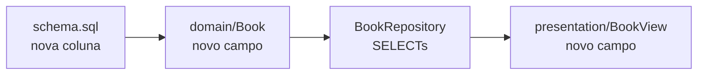

# 04 — Decisões e trade-offs

## Decisões de design

### 1. Três camadas de código + banco, todas fechadas

**Decisão:** `presentation → business → persistence → banco`, sem camadas abertas.
**Por quê:** é a forma canônica do livro e maximiza o isolamento. Com poucas rotas, nenhuma camada extra se paga.
**Custo:** `GET /members/{id}/loans` atravessa o negócio quase sem lógica (sumidouro). Aceitável — é exceção, não regra.

### 2. Regras de camadas verificadas por ArchUnit

**Decisão:** `LayeredArchitectureTest` falha o build se:
- a apresentação acessar a persistência (ou qualquer camada acessar a de cima);
- o `domain` depender de alguma camada;
- código fora da persistência usar JDBC/`java.sql`;
- código fora da apresentação usar `org.springframework.web`/`http`.

**Por quê:** o livro aponta a falta de governança como a causa de o estilo degradar para "grande bola de lama". Uma
regra que só existe em documentação é violada no primeiro prazo apertado; uma regra que quebra o build, não.
**Custo:** uma dependência de teste.

### 3. Pacote `domain` compartilhado, fora das camadas

**Decisão:** `Book`, `Member`, `Loan` são records simples em `domain/`, usados por todas as camadas.
**Alternativas:**

| Opção | Problema |
|-------|----------|
| Entidades na persistência | A apresentação recebe tipos da persistência via negócio → acoplamento indireto ao acesso a dados |
| Entidades no negócio | A persistência dependeria da camada de cima (seta invertida) |
| Um modelo por camada (DTO → modelo de negócio → entidade) | Isolamento máximo, mas muito mapeamento repetitivo para um sistema deste tamanho |

**Por quê:** é o meio-termo pragmático: o domínio não depende de ninguém (verificado por teste) e evita três cópias de
cada classe. A apresentação ainda tem DTOs próprios onde o formato difere do domínio (`BookView`, `BorrowRequest`).
**Custo:** mudar um record do domínio afeta todas as camadas de uma vez (já acontece no estilo de qualquer forma).

### 4. Spring JDBC (`JdbcClient`) em vez de JPA

**Decisão:** SQL explícito nos repositórios.
**Por quê:** torna a camada de persistência **visível** — fica óbvio que só ela fala SQL, e as travas (`FOR UPDATE`) e
escritas condicionais ficam explícitas. Com JPA, parte do acesso a dados "vaza" para o negócio via *lazy loading* e
*dirty checking*.
**Custo:** mais SQL escrito à mão; sem mapeamento automático de relacionamentos.

### 5. Concorrência resolvida pelo banco (trava pessimista)

**Decisão:** `SELECT ... FOR UPDATE` no livro e no membro dentro de uma transação; escrita condicional na devolução.
**Alternativas:** trava otimista (coluna `version`), contador `available_copies` com `UPDATE ... WHERE available > 0`,
nível de isolamento `SERIALIZABLE`.
**Por quê:** para uma biblioteca, a contenção é baixa e a espera de milissegundos é irrelevante; a trava pessimista é a
solução mais simples de entender e testar. O teste de concorrência (20 balcões × 2 exemplares) prova que funciona — e
falha se o `FOR UPDATE` for removido.
**Custo:** sob contenção alta, as transações enfileiram no banco — exatamente o gargalo que o estilo *space-based* existe
para remover. Para este problema, não importa.

### 6. Configuração de regras em `application.yml`

Prazo (14 dias), limite (3) e multa (R$ 2,00/dia, em centavos) são propriedades `library.*` lidas pela camada de negócio.
Valores monetários em **centavos inteiros** para evitar erros de ponto flutuante.

### 7. Datas no fuso da biblioteca

Prazos e multas são **dias de calendário**, então dependem do fuso horário da JVM (`LocalDate.now()`). O
`docker-compose.yml` define `TZ=America/Sao_Paulo`; sem isso, um empréstimo feito às 22h teria data do dia seguinte
(UTC).

## O trade-off central: particionamento técnico

Adicionar **"editora"** ao livro exige mudar:

Quatro lugares, três camadas, para **uma** mudança de domínio. Já trocar o PostgreSQL por outro banco relacional toca
**só** a persistência (e a configuração). O estilo é otimizado para mudanças **técnicas**, não para mudanças de
**domínio** — e, na maioria dos sistemas, as mudanças de domínio são as mais frequentes. Esse é o motivo pelo qual o livro
dá nota baixa para *evolutividade* e pelo qual sistemas grandes tendem a migrar para estilos particionados por domínio.

## Limitações conhecidas (atalhos conscientes)

| Limitação | Por que foi aceita | Como evoluir |
|-----------|-------------------|--------------|
| Sem autenticação/autorização | Foco no estilo, não em segurança | Spring Security na apresentação; papéis (bibliotecário × membro) no negócio |
| Catálogo e membros só via `data.sql` | Mantém a API mínima | `POST /books`, `POST /members` seguindo as mesmas camadas |
| `schema.sql` idempotente em vez de migrações versionadas | Simplicidade | Flyway/Liquibase |
| Sem paginação em `/books` e no histórico | Volumes pequenos | `LIMIT/OFFSET` na persistência, parâmetros na apresentação |
| Fuso horário depende da JVM | Um único local físico | `Clock` injetado e fuso configurável |
| H2 nos testes em vez de PostgreSQL real | Testes rápidos e sem Docker | Testcontainers com PostgreSQL |
| Escala só vertical / réplicas sem estado + banco único | É o limite natural do estilo | Réplicas de leitura; ou mudar de estilo se a carga exigir |

## Riscos de longo prazo

- **Erosão das camadas**: atalhos "só desta vez" da apresentação para o repositório. Mitigação: `LayeredArchitectureTest`.
- **Sumidouro crescente**: se a maioria das rotas virar repasse, reavaliar (camadas abertas ou outro estilo).
- **Monólito que cresce sem fronteiras de domínio**: introduzir subpacotes por domínio cedo (ver [02 — Quando usar](02-quando-usar.md#estratégia-de-evolução)).
