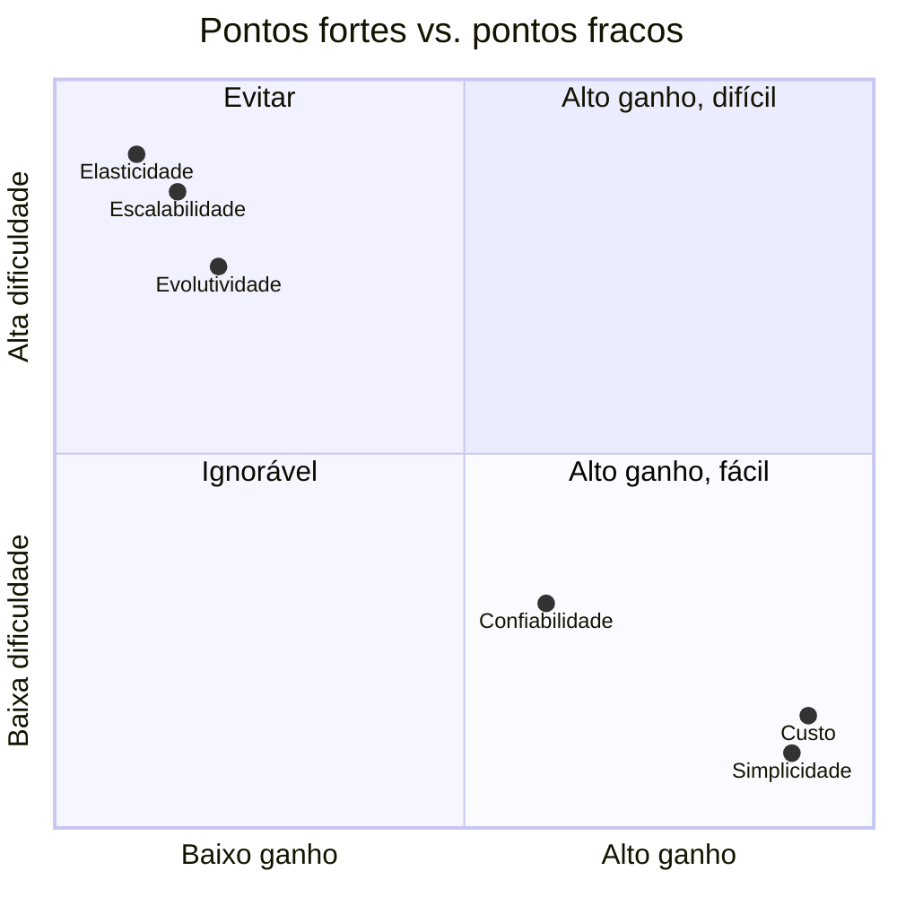
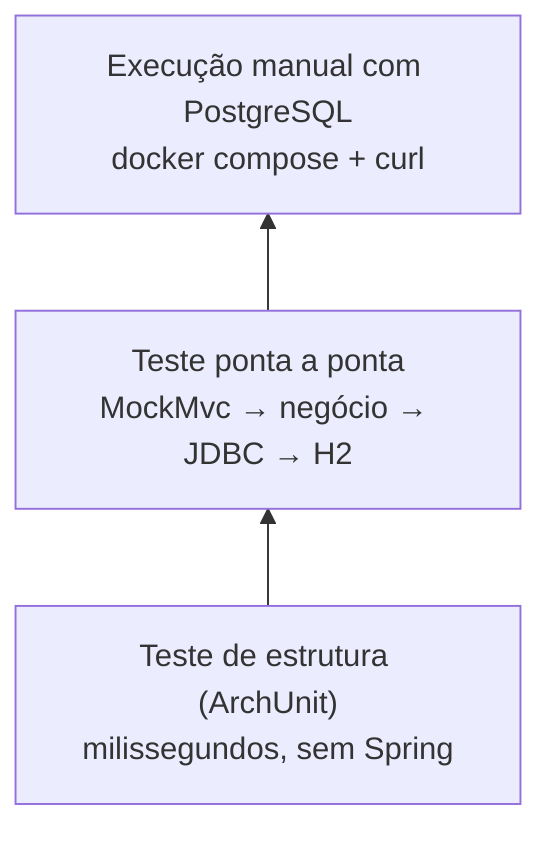

# 05 — Características de arquitetura e como testar

## Avaliação do estilo (tabela do livro, resumida)

| Característica | Nota | Por quê |
|----------------|:----:|---------|
| Custo geral | $ | Um deployable, um banco, padrão conhecido por qualquer time |
| Simplicidade | ★★★★★ | Fácil de entender, explicar e começar |
| Confiabilidade | ★★★ | Transações ACID e poucas partes móveis; mas o processo único é um ponto de falha |
| Testabilidade | ★★ | Camadas isoladas facilitam testes, mas qualquer mudança pede testar o monólito todo |
| Desempenho | ★★ | Toda requisição atravessa as camadas e vai ao banco |
| Implantabilidade | ★ | Qualquer mudança implanta tudo; implantações grandes e arriscadas |
| Elasticidade | ★ | Escala a aplicação inteira; o banco único limita |
| Escalabilidade | ★ | Idem |
| Evolutividade | ★ | Mudanças de domínio atravessam todas as camadas |
| Tolerância a falhas | ★ | Um defeito (ex.: falta de memória) derruba a aplicação inteira |
| Modularidade | ★ | Particionamento técnico; domínios espalhados |

*Valores aproximados, conforme as tabelas do livro; confira a sua edição.*



## Estratégia de testes deste projeto

| Camada / aspecto | O que valida | Onde |
|------------------|--------------|------|
| **Estrutura (camadas fechadas)** | Apresentação não acessa persistência; nenhuma seta para cima; `domain` independente; só persistência usa JDBC; só apresentação usa HTTP | `LayeredArchitectureTest` (ArchUnit) |
| **Fluxo completo** | Empréstimo com prazo de 14 dias, disponibilidade, devolução sem multa, devolução duplicada → `409` | `LibraryApiTest#borrowOnTimeAndReturnWithoutFine` |
| **Último exemplar** | Segundo membro recebe `NO_COPIES_AVAILABLE` | `LibraryApiTest#lastCopyGoesToOnlyOneMember` |
| **Limite por membro** | 4º empréstimo → `LOAN_LIMIT_REACHED` | `LibraryApiTest#memberCannotHoldMoreThanThreeBooks` |
| **Atraso e multa** | Empréstimo vencido bloqueia novos; devolução 5 dias atrasada → R$ 10,00 | `LibraryApiTest#overdueLoanBlocksNewLoansAndIsFinedOnReturn` |
| **Bordas** | Livro/membro/empréstimo inexistente → `404`; corpo inválido → `400` | `LibraryApiTest#unknownResourcesAndInvalidInput` |
| **Concorrência** | 20 balcões simultâneos × 2 exemplares → exatamente 2 empréstimos | `LibraryApiTest#concurrentBorrowersNeverGetMoreCopiesThanExist` |



### Por que os testes atravessam todas as camadas?

A tentação no estilo em camadas é testar cada camada isolada com *mocks* da camada de baixo. Para este sistema, isso
esconderia exatamente o que importa: as regras dependem de **consultas e travas reais** no banco (um *mock* do
repositório nunca reproduziria a corrida no último exemplar). Por isso os testes de comportamento sobem a aplicação
inteira com H2, e a **estrutura** das camadas é testada separadamente, de forma estática, pelo ArchUnit.

### Testes que provam alguma coisa

Dois testes foram validados por **mutação** — introduzindo o defeito e conferindo que falham:

| Defeito introduzido | Teste que falha | Resultado observado |
|---------------------|-----------------|---------------------|
| Remover `FOR UPDATE` de `BookRepository#findByIsbnForUpdate` | `concurrentBorrowersNeverGetMoreCopiesThanExist` | 8 empréstimos para 2 exemplares |
| Injetar `BookRepository` no `BookController` | `LayeredArchitectureTest.layersAreClosed` | violação "Persistence may only be accessed by Business" |

### Executando

```bash
mvn verify                                   # todos os testes automatizados
mvn -Dtest=LayeredArchitectureTest test      # só as regras de camadas
docker compose up -d --build                 # aplicação + PostgreSQL em :8081
```

## Medindo as características na prática

| Característica | Como observar aqui |
|----------------|--------------------|
| Simplicidade | Conte os conceitos necessários para entender o código: 3 pacotes de camadas + 1 de domínio; nenhum middleware |
| Custo | `docker compose ps`: 2 containers |
| Implantabilidade | Mudar só a multa (`library.fine-per-day-cents`) exige reimplantar a aplicação inteira |
| Evolutividade | Experimento 3 do README: uma mudança de domínio toca 4 arquivos em 3 camadas |
| Tolerância a falhas | `docker compose stop library`: todo o sistema fica fora, não só uma funcionalidade |
| Escalabilidade | Réplicas da aplicação são possíveis (ela não guarda estado), mas todas disputam o mesmo banco e as mesmas travas |
