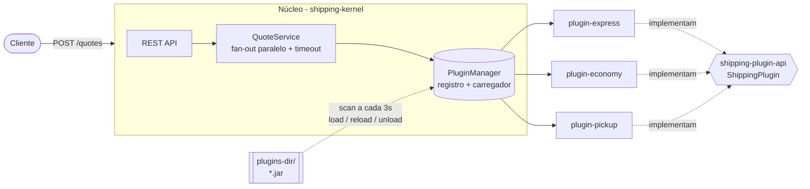

# Microkernel Architecture — Motor de cotação de frete

Implementação de referência do estilo **microkernel** (também chamado *plug-in architecture*) do livro
*Fundamentos da Arquitetura de Software* (Richards & Ford), em **Java 21 e Spring Boot**, com plug-ins carregados
**em tempo de execução** a partir de arquivos `.jar`.

## O problema

Um e-commerce precisa cotar frete. Cada transportadora tem regras, preços e prazos próprios, entram e saem
parceiros o tempo todo, e **cada novo parceiro não pode exigir redeploy nem arriscar a loja inteira**. O fluxo
em si é estável (receber o pedido, perguntar a todos, ordenar por preço); o que varia são as transportadoras.

## A ideia em um parágrafo

O **núcleo (*core system*)** contém só o mínimo para funcionar: validação, orquestração, registro de plug-ins,
carregador e API. Tudo que varia vive em **plug-ins independentes** que obedecem a um **contrato** (`ShippingPlugin`).
Soltar um `.jar` na pasta de plug-ins adiciona uma transportadora; apagar remove; substituir recarrega — sem reiniciar o núcleo.
Um plug-in que falha, trava ou nem carrega **não derruba** os demais.



## Documentação

| Documento | Conteúdo |
|-----------|----------|
| [01 — Conceito](docs/01-conceito.md) | Núcleo, plug-ins, contrato, registro, plug-ins embutidos vs. remotos |
| [02 — Quando usar](docs/02-quando-usar.md) | Critérios de decisão, bons e maus casos de uso, comparação com outros estilos |
| [03 — Arquitetura da implementação](docs/03-arquitetura-da-implementacao.md) | Mapeamento livro → código, ciclo de vida do plug-in, sequência de uma cotação, API |
| [04 — Decisões e trade-offs](docs/04-decisoes-e-tradeoffs.md) | Escolhas de design, limitações conhecidas e como evoluir |
| [05 — Características e testes](docs/05-caracteristicas-e-testes.md) | Avaliação das características de arquitetura e como validar cada uma |

## Estrutura

```
microkernel-architecture/
├── shipping-plugin-api/     # contrato (SPI) compartilhado: ShippingPlugin, QuoteRequest, Quote. Zero dependências
├── shipping-kernel/         # núcleo: PluginManager (registro + class loader por jar), QuoteService, REST API
├── plugins/
│   ├── plugin-express/      # entrega em 1 dia, cara
│   ├── plugin-economy/      # entrega em 7 dias, barata
│   └── plugin-pickup/       # só mesma região e até 5 kg (devolve vazio quando não se aplica)
├── Dockerfile · docker-compose.yml
├── scripts/demo.sh          # demonstra hot load / unload
└── docs/
```

## Como executar

Pré-requisitos: JDK 21+, Maven 3.9+ (Docker opcional).

```bash
# testes (compilam plug-ins reais em tempo de teste e os carregam por jar)
mvn verify

# núcleo local apontando para uma pasta com os jars
mkdir plugins-dir && cp plugins/*/target/plugin-*-SNAPSHOT.jar plugins-dir/
PLUGINS_DIR=plugins-dir java -jar shipping-kernel/target/shipping-kernel-1.0.0-SNAPSHOT.jar

# ou via Docker (monta ./plugins-dir no container)
docker compose up -d --build
scripts/demo.sh
```

### API

| Método | Rota | Descrição |
|--------|------|-----------|
| `POST` | `/quotes` | Corpo `{"originZip":"01000","destinationZip":"01999","weightKg":2}` (CEP com 5 dígitos, peso > 0). Retorna `quotes` (ordenadas por preço) e `failures` (plug-ins que falharam ou estouraram o tempo) |
| `GET` | `/plugins` | Plug-ins ativos (`active`) e jars que não puderam ser carregados (`failed`) |

### Experimentos sugeridos

```bash
# 1. Remova um jar com o sistema no ar: a transportadora some das cotações em ~3s
rm plugins-dir/plugin-express-*.jar

# 2. Devolva o jar: volta sem reiniciar o núcleo
cp plugins/plugin-express/target/plugin-express-*.jar plugins-dir/

# 3. Jar quebrado: aparece em /plugins -> failed, os demais continuam funcionando
echo lixo > plugins-dir/ruim.jar
```

## Limitações (resumo)

Implementação **didática**. Atalhos conscientes em [04 — Decisões e trade-offs](docs/04-decisoes-e-tradeoffs.md):
plug-ins rodam **na mesma JVM** (isolamento de classes, não de recursos), sem versionamento do contrato, sem sandbox de
segurança, detecção de mudanças por *polling*.
