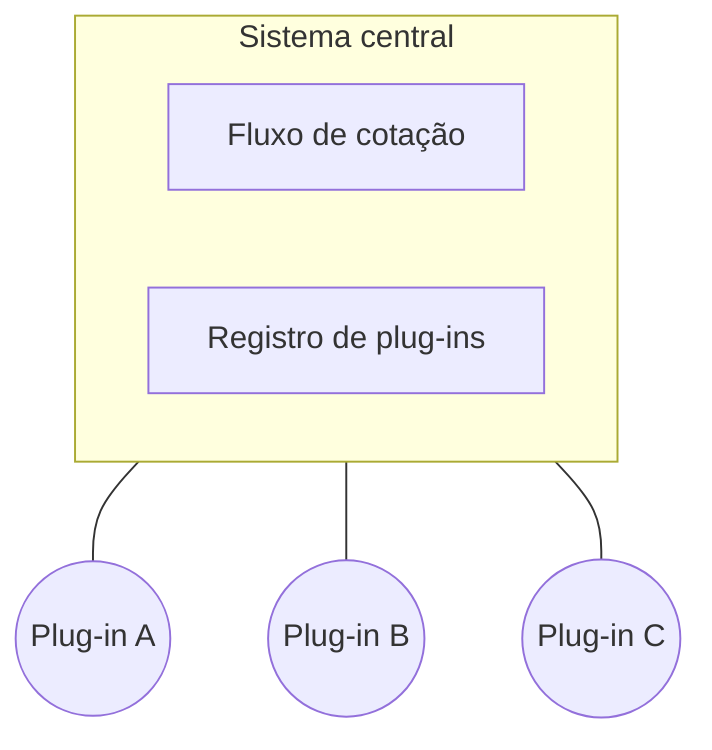

# 01 — Conceito

## Os dois tipos de componente

O estilo microkernel tem apenas dois tipos de componente:

| Componente | Papel | Neste projeto |
|------------|-------|---------------|
| **Sistema central (*core system*)** | Funcionalidade mínima e estável: o fluxo geral, sem as variações | `shipping-kernel` |
| **Plug-ins** | Módulos independentes e **autocontidos** com a lógica que varia, estende ou personaliza | `plugin-express`, `plugin-economy`, `plugin-pickup` |

Regra de ouro: o núcleo **não conhece** nenhum plug-in concreto, só o contrato. Os plug-ins **não conhecem** uns aos
outros — dependem apenas do contrato. Toda a comunicação passa pelo núcleo.

## Contrato (SPI)

O contrato é a única superfície compartilhada. Aqui, `ShippingPlugin`:

- `id()`, `version()` — identidade;
- `quote(QuoteRequest)` — a lógica de negócio; **lista vazia = "não se aplica"**;
- `start()` / `stop()` — ciclo de vida (abrir/fechar recursos).

Ele vive em um módulo **sem dependências** (`shipping-plugin-api`), para que um plug-in não arraste nada do núcleo
(nem Spring) para dentro do seu jar.

## Registro de plug-ins

O núcleo precisa saber **quais plug-ins existem e como chamá-los**. No livro, pode ser uma simples estrutura de dados com
nome, contrato e endereço; aqui é o `PluginManager`, que guarda, por jar, o *class loader* e as instâncias ativas.

## Plug-ins embutidos vs. remotos

| Modelo | Como se conectam | Vantagens | Desvantagens |
|--------|------------------|-----------|--------------|
| **Embutido** (este projeto) | Mesma JVM; jar carregado por *class loader* próprio | Rápido, simples, sem rede | Falha grave (OOM, loop CPU) afeta o processo todo |
| **Remoto** | REST / mensageria entre processos | Isolamento real, linguagens distintas, escala independente | Latência, mais infraestrutura, núcleo vira ponto de integração |

O livro cita ambos; aqui implementamos o embutido, e o [04](04-decisoes-e-tradeoffs.md) mostra como evoluir para remoto
sem mudar o contrato.

## Acoplamento do contrato

O contrato pode ser **padronizado** (todos os plug-ins seguem a mesma interface, como aqui) ou **customizado**, com
adaptadores por plug-in quando se integra software de terceiros. Quanto mais adaptadores, mais o núcleo cresce — o que
vai contra o espírito do estilo.
