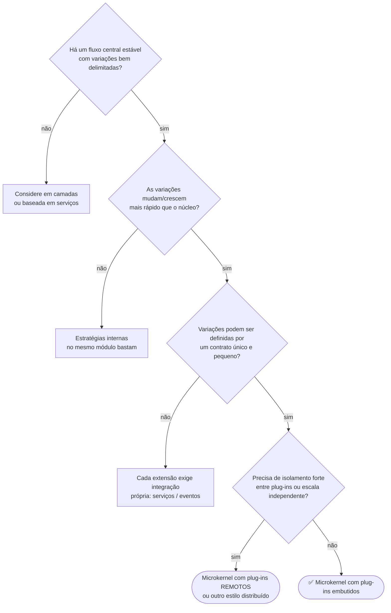

# 02 — Quando usar (e quando não usar)

## Resumo da decisão

Use microkernel quando o produto tem **um fluxo estável e um conjunto de variações que cresce e muda em ritmos
diferentes do núcleo**, e você quer estender sem tocar no que já funciona.

## Sinais de que o estilo é adequado

- **Produtos com extensões de terceiros ou de times diferentes**: IDEs (Eclipse, VS Code), navegadores, ferramentas de CI/CD.
- **Regras por cliente/região/parceiro** sobre um processo comum: cálculo de impostos, sinistros por estado, gateways de pagamento, **transportadoras**.
- Quer **lançar variações sem redeploy do núcleo** e sem regressão no que já está em produção.
- Time do núcleo ≠ time dos plug-ins (ou fornecedores externos).

## Sinais de que NÃO é adequado

- A "variação" é só um `if` — uma interface e três classes dentro do mesmo módulo (padrão *Strategy*) são mais simples.
- Plug-ins precisam **conversar entre si** ou compartilhar muito estado: o contrato explode e o núcleo vira um monólito.
- Requisitos de **escala e elasticidade extremas por extensão** — o estilo, sozinho, escala o núcleo como um todo.
- Plug-ins não confiáveis rodando na mesma JVM sem sandbox.

## Comparação rápida

| | Microkernel | Em camadas | Microsserviços |
|---|---|---|---|
| Extensibilidade | ★★★★ por plug-in | ★ | ★★★★ por serviço |
| Isolamento de falhas | ★★ (embutido) / ★★★★ (remoto) | ★ | ★★★★★ |
| Simplicidade operacional | ★★★ | ★★★★★ | ★ |
| Unidade de deploy | núcleo + jars | uma só | muitas |

É comum **combinar**: microkernel *dentro* de um serviço de um sistema maior (por exemplo, o serviço de frete de uma
arquitetura de microsserviços).
