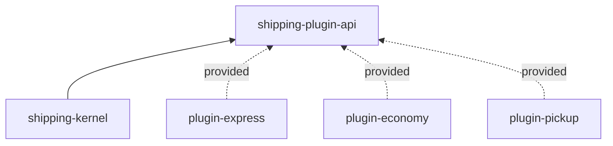
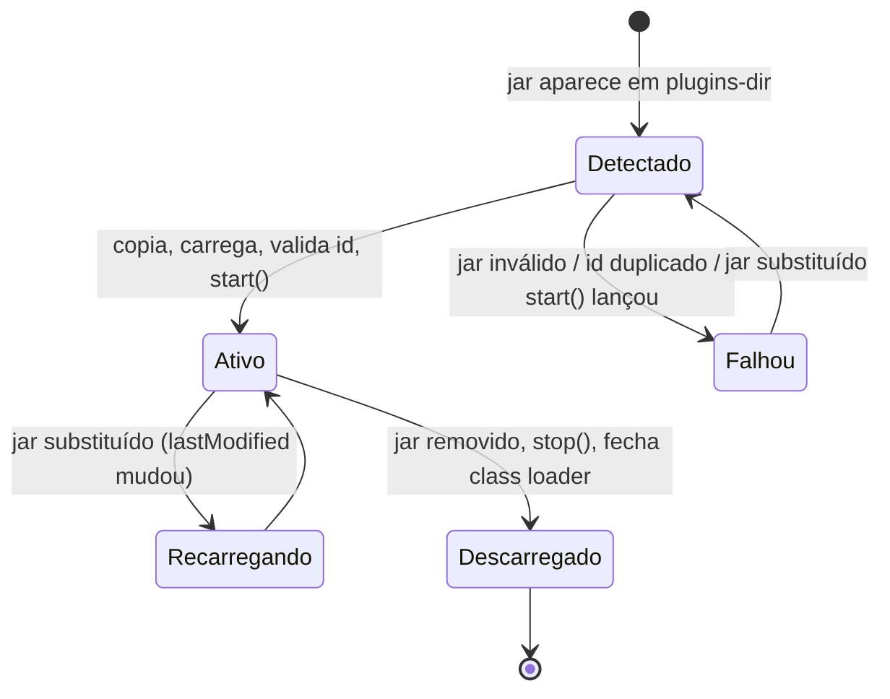
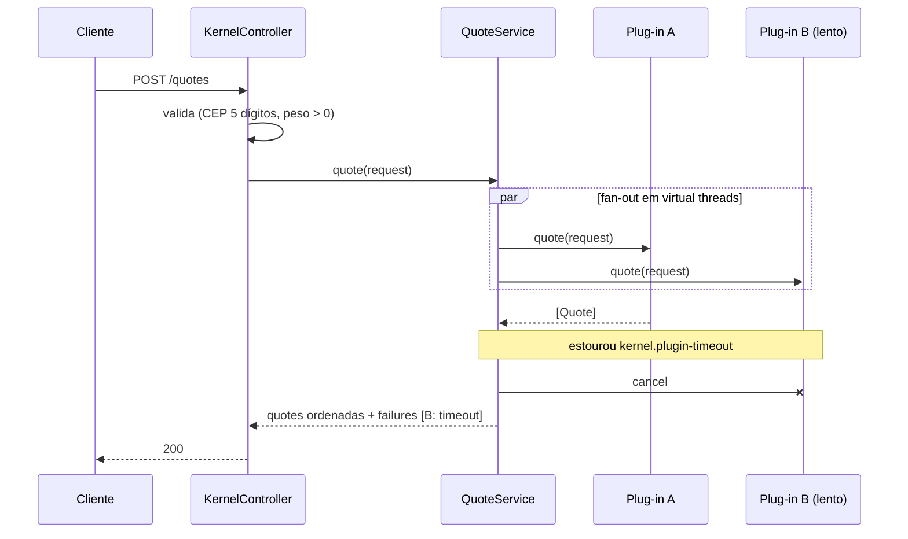

# 03 — Arquitetura da implementação

## Mapeamento livro → código

| Conceito do livro | Código |
|-------------------|--------|
| Sistema central | `shipping-kernel` (`KernelController`, `QuoteService`, `PluginManager`) |
| Contrato do plug-in | `shipping-plugin-api` → `ShippingPlugin` |
| Registro de plug-ins | `PluginManager` (mapa jar → class loader + instâncias) |
| Plug-in | `plugin-express`, `plugin-economy`, `plugin-pickup` (um jar cada, registrado via `META-INF/services`) |
| Descoberta | `java.util.ServiceLoader` sobre um `URLClassLoader` por jar |

## Dependências entre módulos



Núcleo e plug-ins **nunca dependem uns dos outros**. Os plug-ins declaram a API como `provided`: o jar fica minúsculo e,
em tempo de execução, enxerga a **mesma** classe `ShippingPlugin` do núcleo (o *class loader* do jar delega ao pai).

## Ciclo de vida de um plug-in



O `PluginManager.scan()` roda a cada `kernel.scan-interval` (3 s) e compara a pasta com o que está carregado.

## Sequência de uma cotação



Cada plug-in tem seu próprio orçamento de tempo; o pior caso da requisição é **um** timeout, não a soma.

## Detalhes que importam

- **Isolamento de classes**: dois jars podem conter classes com o **mesmo nome totalmente qualificado** sem conflito
  (testado em `PluginManagerTest#sameClassNameInTwoJarsIsIsolated`).
- **Carga a partir de cópia temporária**: no Windows, um `URLClassLoader` trava o arquivo; carregar de uma cópia
  permite apagar/substituir o jar original — que é justamente o hot deploy.
- **Falha de plug-in nunca é falha do núcleo**: exceção ou timeout vira entrada em `failures`; jar inválido vira
  entrada em `GET /plugins → failed`.

## API

Ver [README](../README.md#api). Exemplo:

```json
POST /quotes  {"originZip":"01000","destinationZip":"01999","weightKg":2}
{
  "quotes": [
    {"pluginId":"pickup","quote":{"carrier":"Pickup Point","service":"Collect at store","price":5.00,"deliveryDays":3}},
    {"pluginId":"economy","quote":{"carrier":"Economy Post","service":"Standard","price":11.00,"deliveryDays":7}},
    {"pluginId":"express","quote":{"carrier":"Express Co.","service":"Next day","price":33.00,"deliveryDays":1}}
  ],
  "failures": []
}
```
