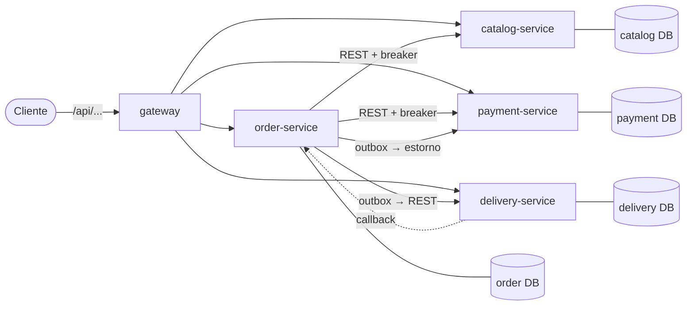

# Microservices — Plataforma de delivery de comida

Implementação de referência do estilo **microsserviços** descrito no livro *Fundamentos da Arquitetura de Software*
(Richards & Ford), em **Java 21, Spring Boot 3, Spring Data JDBC e Resilience4j**.

## O problema

Uma plataforma de delivery tem partes com ritmos muito diferentes: o **cardápio** é lido o tempo todo, o
**pagamento** exige rigor, a **entrega** depende de entregadores e pode demorar. Equipes diferentes querem publicar
sem se esperar, e a queda de uma parte (entrega, pagamento) não deve derrubar o resto. Aqui cada parte é um
**serviço pequeno com seu próprio banco**, e o pedido atravessa serviços por uma **saga com compensação**.

## A ideia em um parágrafo

Quatro serviços de **propósito único** — `catalog`, `order`, `payment`, `delivery` — cada um dono dos seus dados
(**nenhum banco compartilhado**, nenhum módulo de código compartilhado) atrás de um **API gateway** mínimo. O
`order-service` conduz o fluxo: consulta o preço (REST), cobra (REST) e pede a entrega **de forma assíncrona** via
*outbox* transacional; se não houver entregador, **compensa estornando** o pagamento. Chamadas síncronas têm
**timeout e circuit breaker (Resilience4j)**; mensagens assíncronas são retentadas e os receptores são idempotentes.



## Documentação

| Documento | Conteúdo |
|-----------|----------|
| [01 — Conceito](docs/01-conceito.md) | Contexto delimitado, banco por serviço, gateway, saga, comparação com #5 e #6 |
| [02 — Quando usar](docs/02-quando-usar.md) | Critérios de decisão, quando **evitar**, por que delivery de comida |
| [03 — Arquitetura da implementação](docs/03-arquitetura-da-implementacao.md) | Mapeamento livro → código, sequências (saga, compensação), API, falhas |
| [04 — Decisões e trade-offs](docs/04-decisoes-e-tradeoffs.md) | Escolhas, custos (operação, dados distribuídos, consistência eventual), riscos e evolução |
| [05 — Características e testes](docs/05-caracteristicas-e-testes.md) | Avaliação das características e como cada uma é validada |

## Estrutura

```
microservices-architecture/
├── gateway/            # entrada única: roteia /api/{rota}/** (:8100 no compose)
├── catalog-service/    # itens e preços — banco próprio (:8101)
├── order-service/      # pedido + saga + outbox + circuit breaker — banco próprio (:8102)
├── payment-service/    # autoriza (idempotente) e estorna — banco próprio (:8103)
├── delivery-service/   # atribui entregador, conclui, avisa o pedido por callback — banco próprio (:8104)
├── e2e-tests/          # gateway + 4 serviços, cada um em seu contexto Spring, porta e banco H2
├── Dockerfile · docker-compose.yml   # 4 × PostgreSQL + 4 serviços + gateway
└── docs/
```

## Como executar

Pré-requisitos: JDK 21+, Maven 3.9+ (Docker opcional).

```bash
# testes unitários por serviço + e2e (sem Docker)
mvn verify

# topologia completa: 4 PostgreSQL + 4 serviços + gateway
docker compose up -d --build
```

```bash
GW=localhost:8100/api
curl -s -X POST $GW/catalog/items -H 'Content-Type: application/json' -d '{"name":"Burger","priceCents":3500}'
# -> {"id":1,...}
curl -s -X POST $GW/orders/orders -H 'Content-Type: application/json' \
  -d '{"customerId":"ana","itemId":1,"quantity":2,"address":"Rua A, 1"}'
# -> 201 {"id":1,"status":"PAID",...}        (pago; a entrega é confirmada depois, assincronamente)
curl -s $GW/orders/orders/1                    # CONFIRMED + courier
curl -s -X POST $GW/deliveries/deliveries/1/complete
curl -s $GW/orders/orders/1                    # DELIVERED
```

Regras de demonstração: pagamento **recusado acima de 100.000 centavos** (`PAYMENT_LIMIT_CENTS`); o compose sobe **1
entregador** (`DELIVERY_COURIERS=1`): o segundo pedido simultâneo vira `CANCELLED` e o pagamento, `REFUNDED`.

### Experimentos sugeridos

```bash
# 1. Compensação: crie um pedido SEM concluí-lo (ocupa o único entregador); o seguinte é cancelado e estornado
curl -s -X POST $GW/orders/orders -H 'Content-Type: application/json' -d '{"customerId":"bia","itemId":1,"quantity":1,"address":"Rua B, 2"}'
curl -s $GW/orders/orders/2 ; curl -s $GW/payments/payments/2      # CANCELLED / REFUNDED

# 2. Entrega fora do ar: pedido fica PAID e é confirmado quando o serviço volta (outbox)
docker compose stop delivery-service
curl -s -X POST $GW/orders/orders -H 'Content-Type: application/json' -d '{"customerId":"caio","itemId":1,"quantity":1,"address":"Rua C, 3"}'
docker compose start delivery-service

# 3. Pagamento fora do ar: 503 rápido (timeout → breaker aberto); volta sozinho após o serviço retornar
docker compose stop payment-service
```

## Limitações (resumo)

Implementação **didática**; atalhos conscientes em [04 — Decisões e trade-offs](docs/04-decisoes-e-tradeoffs.md):
gateway sem autenticação/rate limit, relay do outbox sem *lock*/backoff/DLQ, sem reconciliação de pedidos `PENDING`,
sem *tracing*, esquema por `schema.sql` (sem Flyway) e descoberta por URL fixa. O `docker-compose.yml` teve a sintaxe
validada (`docker compose config`), mas **não foi executado** (daemon Docker indisponível no desenvolvimento); o
comportamento é validado pelo e2e, que sobe os mesmos serviços sem Docker.
