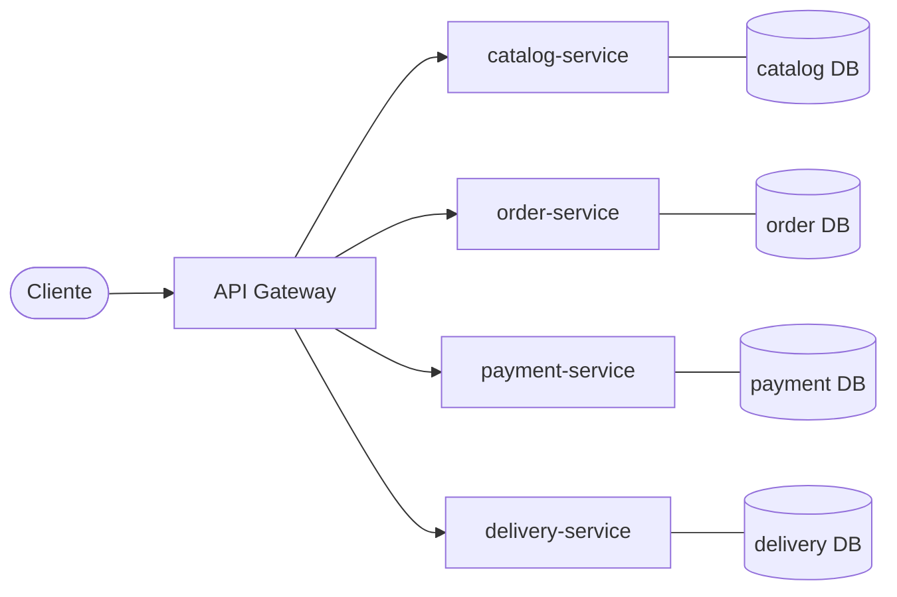

# 01 — Conceito

## O que é

Na arquitetura de **microsserviços** o sistema é um conjunto de serviços **pequenos, de propósito único, implantados
de forma independente**, cada um dono do **seu próprio dado**. A ideia central do livro é o **contexto delimitado**
(*bounded context*, do DDD): cada serviço encapsula **tudo** de um pedaço do domínio — lógica, regras **e banco** — e
só se expõe por um contrato (API). Duplicar código e modelo entre serviços é aceito de propósito: o acoplamento é
pior que a duplicação.

| Ideia | O que significa |
|-------|-----------------|
| **Contexto delimitado** | Um serviço = um pedaço coeso do domínio (catálogo, pedido, pagamento, entrega). O modelo interno não vaza. |
| **Um banco por serviço** | Nenhum serviço lê a tabela do outro; só a API. Permite trocar tecnologia e evoluir esquema sem coordenar. |
| **Implantação independente** | Cada serviço tem seu build, seu processo, sua escala e seu ciclo de release. |
| **Granularidade** | Pequeno o bastante para ter **um propósito**; grande o bastante para **não precisar de transação com outro**. |
| **API gateway** | Ponto único de entrada: roteia (e, em produção, autentica, limita taxa). Não tem regra de negócio. |
| **Comunicação** | Síncrona (REST) quando o cliente precisa da resposta; assíncrona quando o passo é lento ou o destino pode estar fora. |
| **Sem transação distribuída** | Fluxos entre serviços usam **saga**: passos locais + **compensações**; a consistência é *eventual*. |
| **Resiliência** | A rede falha: *timeout*, *circuit breaker*, idempotência e retentativas não são opcionais. |

## Diferença para os estilos vizinhos

| | Baseada em serviços (#5) | Orientada a eventos (#6) | **Microsserviços (#8)** |
|-|--------------------------|--------------------------|-------------------------|
| Granularidade | Grossa (4–12 serviços de domínio) | Processadores de evento | **Fina**, um propósito |
| Dados | **Banco compartilhado** | Por processador | **Um por serviço, sempre** |
| Transações | ACID local ao banco compartilhado | Eventos + compensação | **Saga** + compensação |
| Acoplamento de código | Módulo de persistência comum | Contratos de evento comuns | **Nada compartilhado** (cada um tem sua cópia) |
| Custo operacional | Moderado | Alto (broker) | **Muito alto** (N deploys, N bancos, rede) |

## Ideias-chave

- **“Compartilhe o mínimo possível.”** Aqui não existe módulo `shared`: o `order-service` tem *sua* classe `Item`,
  o `delivery-service` tem *seu* callback. Mudar o catálogo não obriga recompilar o pedido.
- **Rede não é método.** Toda chamada entre serviços pode demorar, falhar ou executar duas vezes. O código precisa
  assumir isso (timeouts, breaker, chaves de idempotência).
- **Consistência eventual é o preço da autonomia.** Existe uma janela em que o pedido está `PAID` mas a entrega ainda
  não foi confirmada — e o sistema precisa estar correto nela.
- **Microsserviços são uma decisão organizacional tanto quanto técnica**: valem quando times diferentes precisam
  entregar sem se esperar (Lei de Conway).
