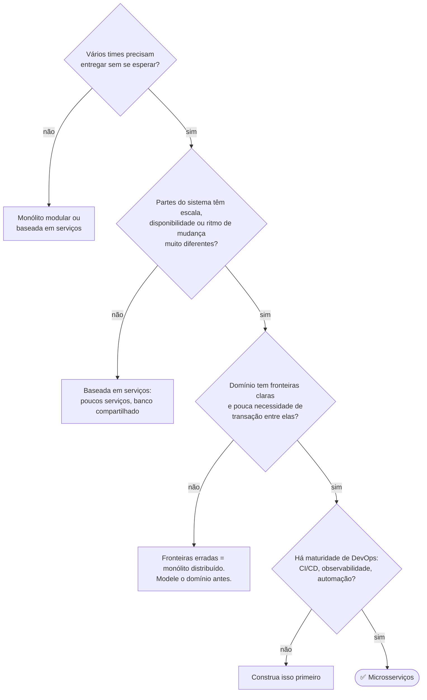

# 02 — Quando usar (e quando não usar)

## Resumo da decisão

Microsserviços compram **agilidade de times, escala seletiva e isolamento de falhas** pagando com **complexidade
operacional e de dados distribuídos**. Se você não sente a dor que eles curam, só vai sentir o custo.

## Sinais de que o estilo é adequado

- **Times autônomos** donos de partes do domínio, com releases independentes e frequentes.
- Cargas **muito desiguais**: o catálogo recebe 100× mais leituras que o pagamento; escalar só o que precisa economiza.
- Requisitos de **disponibilidade/isolamento**: a queda do serviço de entrega não pode impedir o cliente de pedir.
- **Tecnologias diferentes** fazem sentido por serviço (busca, grafo, relacional).
- Domínio com **contextos delimitados claros** e poucas transações atravessando-os.

## Sinais de alerta (evite)

- Time pequeno ou produto novo com **domínio ainda mudando**: fronteiras erradas custam caro de desfazer na rede.
- Precisa de **transações ACID** entre quase tudo (financeiro contábil, estoque estrito em muitas entidades).
- **Sem** CI/CD, *tracing*, métricas centralizadas, orquestração (Kubernetes ou similar): você vai depurar no escuro.
- Muitos serviços **chamando-se em cadeia síncrona**: latência e disponibilidade se multiplicam (0,99⁵ ≈ 95%).
- **Banco compartilhado “só por enquanto”**: é o caminho do monólito distribuído (pior dos dois mundos).

| Situação | Melhor estilo |
|----------|---------------|
| Startup validando produto, 1 time | Camadas / monólito modular |
| Poucos domínios grandes, equipe média, transações importam | Baseada em serviços (#5) |
| Reação a fatos, muitos assinantes, fluxo assíncrono | Orientada a eventos (#6) |
| Muitos times, escala e deploy independentes, domínio maduro | **Microsserviços** |

## Por que **delivery de comida** foi o caso escolhido

1. Domínio com **contextos naturalmente separados** (catálogo, pedido, pagamento, entrega) donos de dados diferentes.
2. **Escalas desiguais**: o cardápio é lido o tempo todo; pagamentos são raros; entrega depende de entregadores.
3. Um fluxo que **atravessa serviços** e **pode falhar no meio** (pago, mas sem entregador) — força a **saga com
   compensação (estorno)**, o problema central do estilo.
4. Parte síncrona (o cliente espera a cobrança) e parte assíncrona (entrega confirma depois), o que justifica
   **os dois tipos de comunicação**.
5. Falhas reais de rede (pagamento fora do ar, entrega fora do ar) são fáceis de demonstrar e testar.

> Honestamente: este exemplo é **pequeno demais** para *precisar* de microsserviços. Ele existe para mostrar os
> mecanismos; num produto real você começaria por um monólito modular e extrairia serviços sob dor comprovada.
