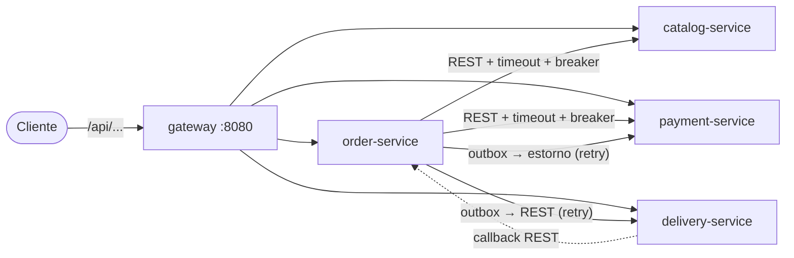
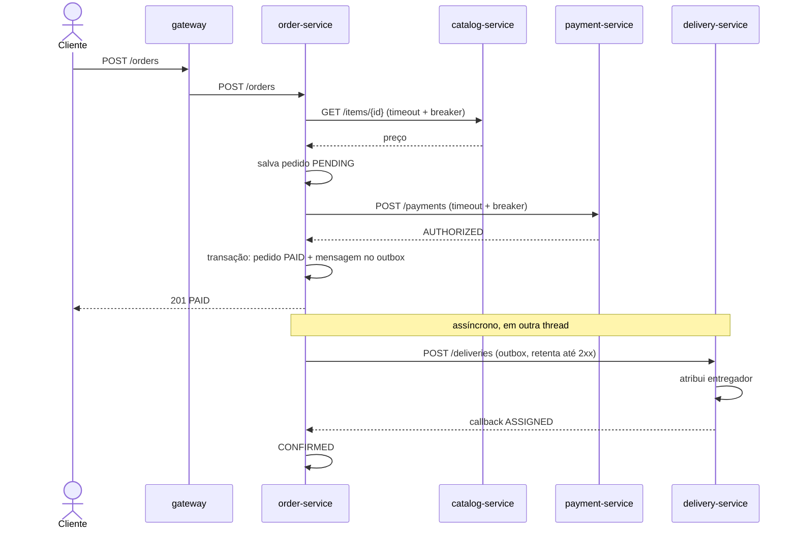
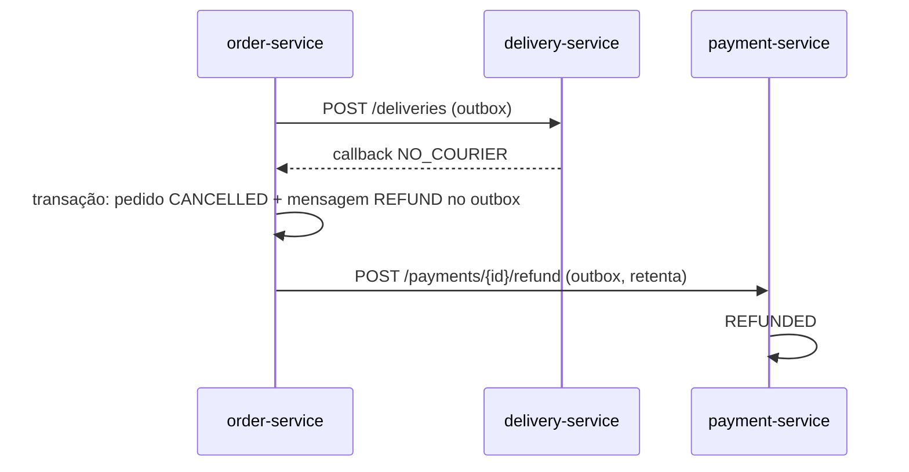
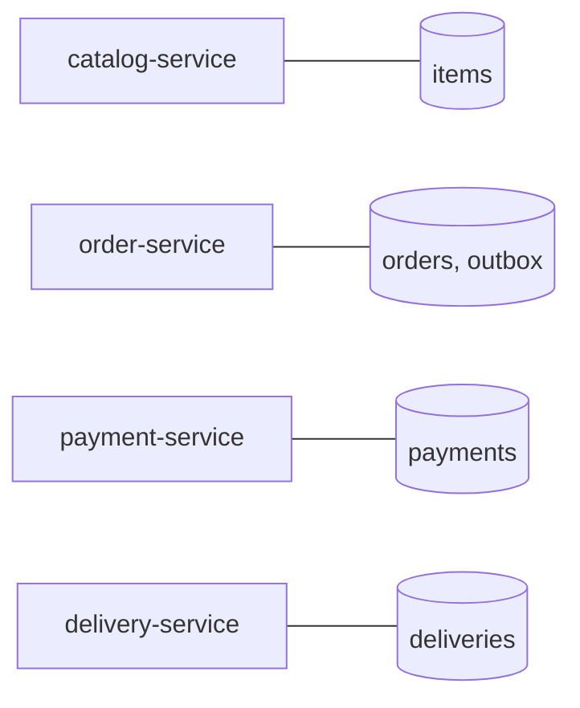

# 03 — Arquitetura da implementação

## Mapeamento livro → código

| Conceito | Onde está |
|----------|-----------|
| Contexto delimitado: catálogo | `catalog-service` — tabela `items` |
| Contexto delimitado: pedido + saga | `order-service` — tabelas `orders` e `outbox` |
| Contexto delimitado: pagamento | `payment-service` — tabela `payments` |
| Contexto delimitado: entrega | `delivery-service` — tabela `deliveries` |
| API gateway | `gateway` — proxy reverso `/api/{rota}/**`, sem regra de negócio |
| Banco por serviço | `application`/`*.properties` próprios; no compose, **4 PostgreSQL**; nos testes, 4 H2 distintos |
| Sem código compartilhado | Não há módulo comum; `order-service` tem `CatalogClient.Item` e `PaymentClient.Payment` próprios |
| Resiliência | `Downstream`: *timeout* HTTP + *circuit breaker* **Resilience4j** |
| Saga com compensação | `OrderService` (+ `OutboxRelay`) |
| Mensagem assíncrona confiável | **Outbox transacional** em `order-service` |

## API (via gateway: `http://localhost:8100/api/...`)

| Rota no gateway | Serviço | Descrição |
|-----------------|---------|-----------|
| `POST /api/catalog/items` · `GET /api/catalog/items[/{id}]` | catalog | `{"name","priceCents"}` |
| `POST /api/orders/orders` · `GET /api/orders/orders/{id}` | order | `{"customerId","itemId","quantity"(1-10),"address"}` → `201` + pedido |
| `POST /api/payments/payments` · `GET .../{id}` · `POST .../{id}/refund` | payment | autoriza (idempotente por pedido), consulta, estorna |
| `POST /api/deliveries/deliveries` · `GET .../{orderId}` · `POST .../{orderId}/complete` | delivery | despacha, consulta, conclui |

Estados do pedido: `PENDING → PAID → CONFIRMED → DELIVERED`, ou `REJECTED` (pagamento recusado/indisponível;
nada cobrado) ou `CANCELLED` (cobrado, **sem entregador**, estornado).

## A saga de “fazer pedido” (orquestrada pelo `order-service`)

### Compensação: pago, mas sem entregador

Não há “rollback” global: o `order-service` **desfaz o efeito** do passo anterior com uma ação de negócio (estorno).

### Falhas e o que o sistema faz

| Falha | Comportamento |
|-------|---------------|
| `catalog` fora/lento | `503` imediato (breaker aberto) — **nenhum pedido é criado** |
| `payment` fora/lento | pedido `REJECTED (payment unavailable)` e `503`; breaker abre após falhas repetidas e fecha sozinho (half-open) |
| pagamento recusado | pedido `REJECTED`, nada despachado |
| `delivery` fora | pedido fica `PAID`; mensagem espera no outbox; ao voltar, é entregue → `CONFIRMED` |
| callback duplicado/atrasado | ignorado (transições só a partir do estado esperado) |
| `order-service` cai entre pagar e gravar | ver riscos em [04](04-decisoes-e-tradeoffs.md) |

## Dados: um banco por serviço

`order` guarda só `itemId`/`paymentId` — **referências por id**, sem chave estrangeira entre bancos. Não existe `JOIN`
entre contextos: quem precisa de dado de outro serviço **pergunta pela API** (ex.: preço) ou **guarda uma cópia**.
