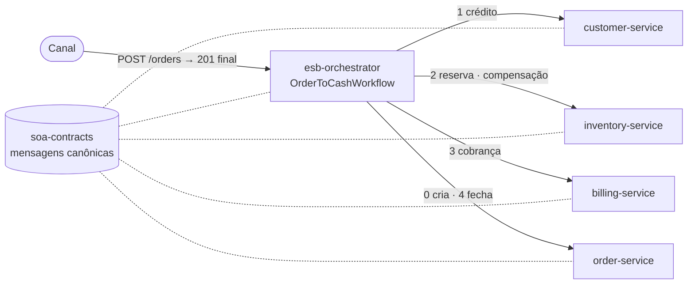

# Orchestration-Driven SOA — Order-to-cash corporativo

Implementação de referência da **arquitetura orientada a serviços orquestrada** (*orchestration-driven
service-oriented architecture*) do livro *Fundamentos da Arquitetura de Software* (Richards & Ford), em
**Java 21 e Spring Boot**: um **orquestrador no estilo ESB** coordena serviços de negócio reutilizáveis
(Cliente, Estoque, Cobrança, Pedido) sobre uma **camada de mensagens canônicas**.

## O problema

Uma empresa grande processa pedidos passando por sistemas de donos diferentes: validar o cliente, reservar estoque,
cobrar e registrar. Cada área expõe sua capacidade como **serviço corporativo reutilizável**, e um **motor de
orquestração** central define o processo: sequência, desvios e compensações. Nenhum serviço conhece outro.

## A ideia em um parágrafo

Os **serviços são passivos**: respondem a mensagens no formato **canônico** e não chamam ninguém. Quem conhece o
processo é o **orquestrador** (`OrderToCashWorkflow`): cria o pedido, checa crédito, reserva estoque, cobra e fecha;
se a cobrança é recusada, **desfaz** a reserva; se um serviço cai, **compensa** e responde `502`. O canal recebe o
**desfecho final de forma síncrona**, com o *trace* dos passos. É ótimo para **reuso e governança** e ruim para
**evolutividade, elasticidade e disponibilidade**: tudo passa pelo centro.



## Documentação

| Documento | Conteúdo |
|-----------|----------|
| [01 — Conceito](docs/01-conceito.md) | SOA, taxonomia de serviços, ESB, contrato canônico, ascensão e queda |
| [02 — Quando usar](docs/02-quando-usar.md) | Critérios de decisão, bons e maus casos de uso, comparação com outros estilos |
| [03 — Arquitetura da implementação](docs/03-arquitetura-da-implementacao.md) | Mapeamento livro → código, sequências (sucesso, recusa, falha), API |
| [04 — Decisões e trade-offs](docs/04-decisoes-e-tradeoffs.md) | Acoplamento, gargalo, idempotência, limitações e quando migrar |
| [05 — Características e testes](docs/05-caracteristicas-e-testes.md) | Avaliação das características de arquitetura e como validar cada uma |

## Estrutura

```
orchestration-driven-soa-architecture/
├── soa-contracts/        # mensagens canônicas (records): o ÚNICO código compartilhado
├── esb-orchestrator/     # motor de orquestração: workflow, compensação, gateways REST (:8100)
├── customer-service/     # verificação de crédito do cliente (:8101)
├── inventory-service/    # estoque: reserva e liberação idempotentes (:8102)
├── billing-service/      # cobrança; recusa acima de um limite (:8103)
├── order-service/        # sistema de registro do pedido (:8104)
├── e2e-tests/            # orquestrador + 4 serviços, cada um em seu contexto Spring, via HTTP
├── Dockerfile · docker-compose.yml
└── docs/
```

## Como executar

Pré-requisitos: JDK 21+, Maven 3.9+ (Docker opcional).

```bash
# testes unitários + E2E (5 contextos Spring em portas reais) — não precisa de Docker
mvn verify

# topologia completa: orquestrador + 4 serviços
docker compose up -d --build
```

```bash
# estoque inicial do compose: console=5, phone=100; clientes: ana, bruno
curl -s -X POST localhost:8100/orders -H 'Content-Type: application/json' \
  -d '{"customerId":"ana","sku":"console","quantity":1,"unitPriceCents":300000}'
# -> 201 {"order":{"status":"CONFIRMED",...},"steps":[{"service":"order","operation":"create",...},...]}

curl -s localhost:8100/orders/<id>
curl -s localhost:8102/stock/console              # 4
```

Regras de demonstração: cobrança **recusada acima de 1.000.000 centavos** (`BILLING_LIMIT_CENTS`); crédito de `ana` 5.000.000 e de
`bruno` 1.000.000 (`CUSTOMER_INITIAL`); `quantity` > estoque cancela o pedido. A API completa está no
[doc 03](docs/03-arquitetura-da-implementacao.md#api).

### Experimentos sugeridos

```bash
# 1. Recusa de cobrança: o orquestrador devolve o estoque (veja 'inventory.release' no trace)
curl -s -X POST localhost:8100/orders -H 'Content-Type: application/json' \
  -d '{"customerId":"ana","sku":"console","quantity":1,"unitPriceCents":2000000}'

# 2. Serviço fora do ar: 502, estoque devolvido, pedido CANCELLED
docker compose stop billing-service

# 3. Ponto único de falha: sem orquestrador, nada funciona, com todos os serviços saudáveis
docker compose stop esb-orchestrator
```

## Limitações (resumo)

Implementação **didática**; atalhos conscientes em [04 — Decisões e trade-offs](docs/04-decisoes-e-tradeoffs.md):
estado em memória, sem estorno de cobrança (falha pós-cobrança exige reconciliação), sem retry/circuit breaker,
orquestração em código (não BPEL/BPMN) e processo preso à requisição HTTP. O `docker-compose.yml` foi validado com
`docker compose config`, mas não executado ponta a ponta.
