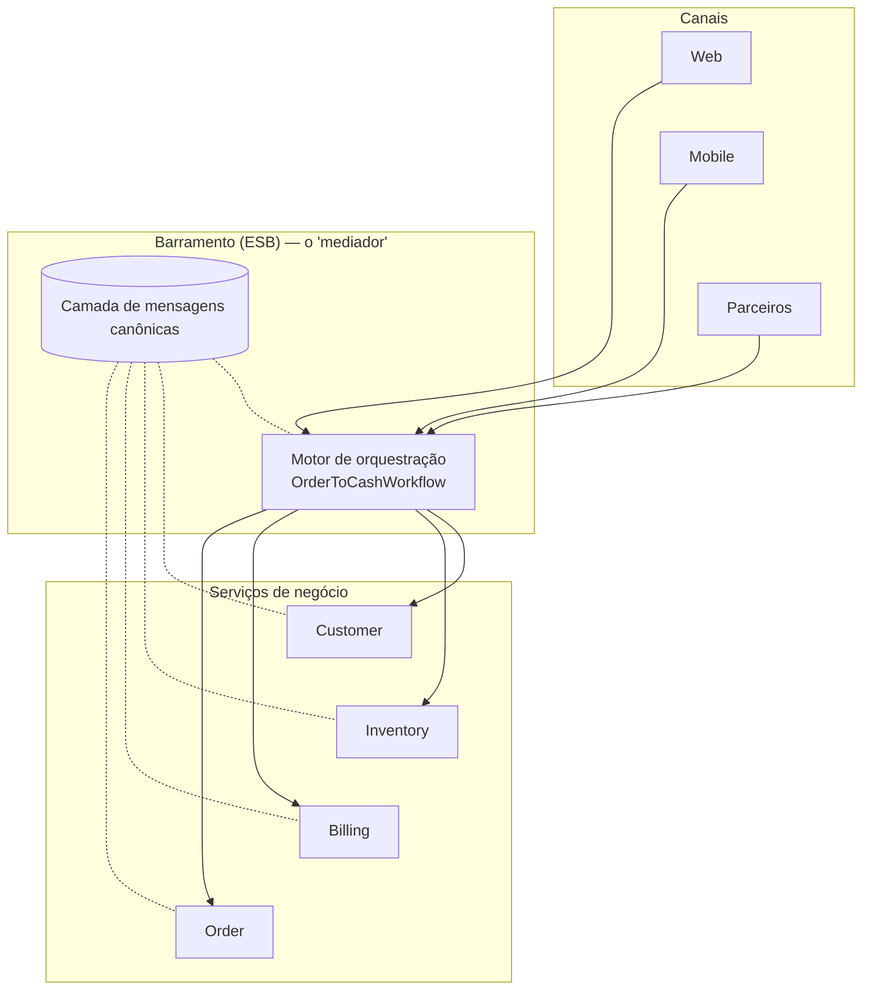

# 01 — Conceito

## O que é

A **arquitetura orientada a serviços orquestrada** (*orchestration-driven service-oriented architecture*) é o estilo
de SOA dos anos 2000: uma **taxonomia de serviços por camada** coordenada por um **barramento de serviços corporativo**
(ESB) com um **motor de orquestração** no centro. O objetivo original era **reuso**: cada capacidade de negócio
(Cliente, Estoque, Cobrança, Pedido) vira um serviço compartilhado por toda a empresa, e os processos são
**compostos** por cima deles.

## Taxonomia do livro

| Camada | Papel | Neste projeto |
|--------|-------|---------------|
| **Serviços de negócio** | Fluxo de entrada abstrato (ex.: `ExecutarOrdem`); sem lógica, só definem o processo | `POST /orders` do orquestrador |
| **Serviços corporativos** | Granularidade grossa, **reutilizáveis** entre processos; "blocos de montar" | `customer`, `inventory`, `billing`, `order` |
| **Serviços de aplicação** | Operações de uma só aplicação, sem reuso | fora do escopo (ficariam dentro de cada serviço) |
| **Serviços de infraestrutura** | Log, auditoria, segurança | o *trace* de passos devolvido pelo orquestrador |
| **Orquestração (ESB)** | Liga tudo: coreografia de chamadas, transformação, roteamento | `esb-orchestrator` |

> Simplificação consciente: o livro separa "serviços de negócio" (definição abstrata) dos "corporativos"
> (implementação). Aqui o fluxo abstrato **é** o `OrderToCashWorkflow`; os corporativos são os 4 serviços.

## Ideias-chave

- **Orquestrador dono do processo**: só ele conhece a sequência (crédito → estoque → cobrança → fechamento), os
  desvios e as **compensações**. Os serviços são **passivos** e **nunca chamam uns aos outros**.
- **Contrato canônico**: uma única linguagem corporativa (`soa-contracts`, classe `Canonical`). Ninguém traduz modelos
  entre serviços; em troca, mudar uma mensagem canônica afeta todos.
- **Reuso como princípio**: o serviço de cliente não sabe o que é um pedido; qualquer outro processo (cadastro,
  fidelidade) poderia chamá-lo igual.
- **Particionamento técnico**: serviços por capacidade de negócio, mas um processo atravessa todos, então uma mudança
  de fluxo mexe no orquestrador **e** nos contratos.
- **Síncrono e centralizado**: o chamador espera o desfecho final (`201` com `CONFIRMED`/`CANCELLED`), diferente da
  [arquitetura orientada a eventos](../../event-driven-architecture).

## Por que o estilo ficou famoso (e depois impopular)

Prometia reuso total e agilidade ("remonte processos sem tocar nos serviços"). Na prática, a **camada de reuso criou
acoplamento**: tudo depende do mesmo contrato canônico e do mesmo ESB, as mudanças viram projetos coordenados entre
equipes, e o ESB se tornou gargalo organizacional e técnico. Microsserviços (estilo #8) reagiram exatamente a isso.
