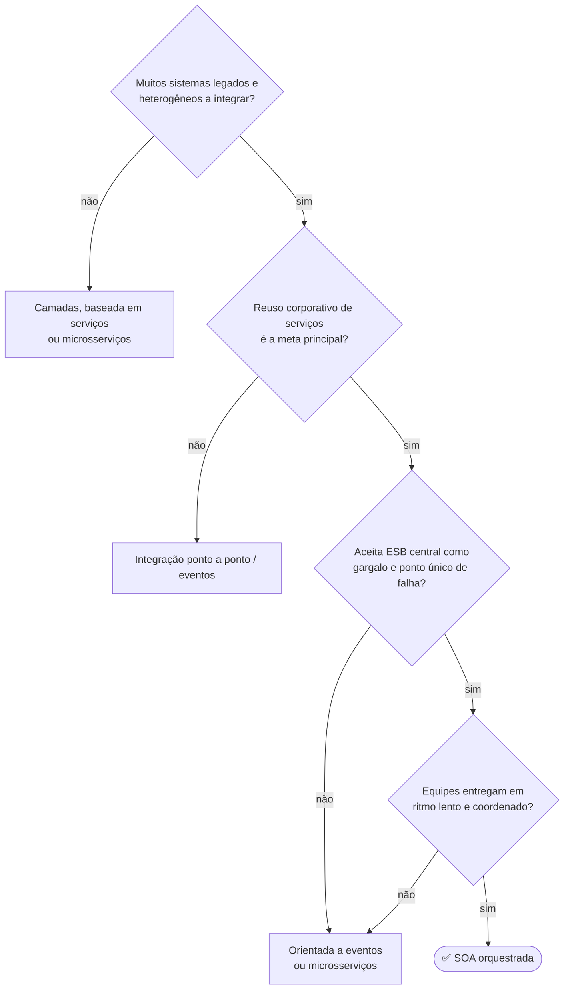

# 02 — Quando usar (e quando não usar)

## Resumo da decisão

Use SOA orquestrada **só quando** o contexto é uma **grande empresa com muitos sistemas legados heterogêneos** a
integrar, com governança central forte e processos de negócio longos que **reaproveitam os mesmos serviços**. Para um
sistema novo e coeso, quase sempre há estilos melhores.

## Sinais de que o estilo é adequado

- **Integração corporativa**: ERP, CRM, mainframe, parceiros externos em protocolos diferentes; o ESB traduz.
- **Reuso real** de capacidades (a mesma validação de cliente em pedido, contrato, cobrança).
- **Governança central**: auditoria, segurança e SLAs por um time de arquitetura.
- Processos de negócio **longos e bem definidos**, com orquestração explícita e compensação.
- Organização **centralizada**, com equipes que aceitam coordenar releases.

| Domínio | Por que encaixa |
|---------|-----------------|
| *Order-to-cash* corporativo (pedido → crédito → estoque → faturamento) | Processo fixo, vários sistemas de donos distintos, auditável |
| Bancos e seguros (legados + canais novos) | Integração de núcleos antigos exposta como serviços reutilizáveis |
| Governo / grandes holdings | Governança e padronização acima de velocidade |

### Por que **order-to-cash** foi o caso escolhido

1. O processo é uma **sequência com dependências** (só cobra quem tem crédito e estoque) e **desvios** (recusas).
2. Há **compensação** (cobrança recusada → devolver estoque) que só faz sentido se alguém enxerga o processo inteiro.
3. Os serviços são **reutilizáveis**: `customer` e `order` servem a outros processos.

## Quando **não** usar

| Situação | Por quê |
|----------|---------|
| Precisa de **evolutividade e entrega contínua** | Mudou o processo → mexe no orquestrador e nos contratos canônicos; releases coordenadas |
| Precisa de **alta elasticidade/escala** por capacidade | O orquestrador (e o ESB) é gargalo compartilhado por todas as requisições |
| **Alta disponibilidade** exigida | O orquestrador é **ponto único de falha** |
| Sistema novo, equipe pequena | A "camada de reuso" é custo sem retorno; o reuso quase nunca se materializa |
| Equipes autônomas por domínio | O contrato canônico e o ESB amarram todas |
| Fluxo simples e síncrono | Um módulo em camadas resolve com bem menos peças |

## Comparação rápida

| Estilo | Quem coordena o fluxo | Acoplamento | Reuso | Evolutividade |
|--------|----------------------|-------------|-------|---------------|
| Baseada em serviços | Chamadas diretas / gateway | Médio (banco único) | Médio | Média |
| Orientada a eventos (broker) | Ninguém (emerge dos eventos) | Mínimo | Baixo | Alta |
| **SOA orquestrada** | **Orquestrador central (ESB)** | **Alto (contrato canônico + ESB)** | **Máximo (meta)** | **Baixa** |
| Microsserviços | Coreografia / orquestração local | Baixo (contexto delimitado) | Mínimo (duplica de propósito) | Muito alta |
