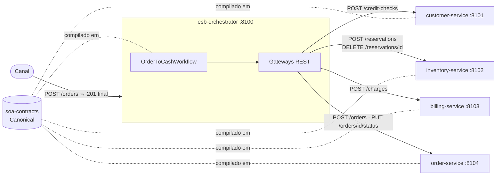
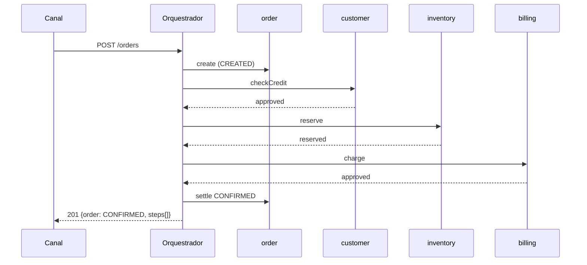
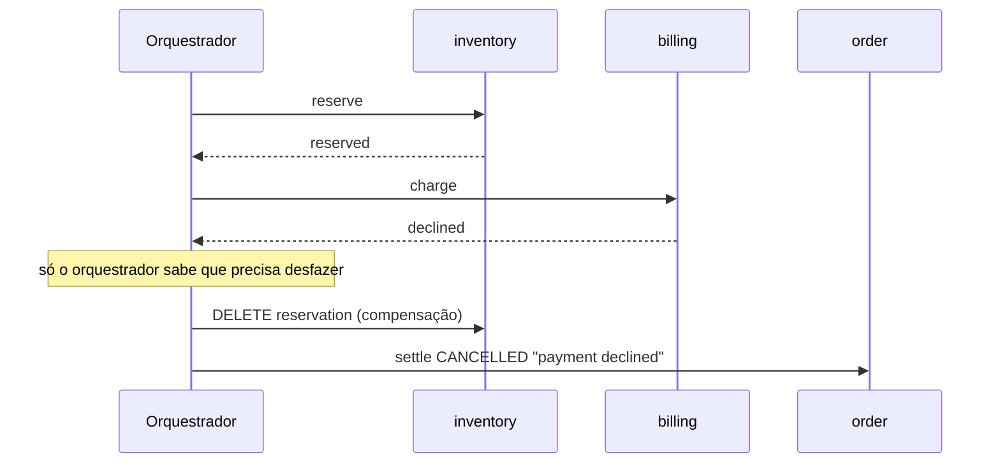

# 03 — Arquitetura da implementação

## Mapeamento livro → código

| Conceito do livro | Onde está |
|-------------------|-----------|
| ESB / motor de orquestração | [`esb-orchestrator`](../esb-orchestrator): `OrderToCashWorkflow` |
| Serviços corporativos reutilizáveis | `customer-service`, `inventory-service`, `billing-service`, `order-service` |
| Camada de mensagens canônicas | [`soa-contracts`](../soa-contracts): `Canonical` (records) — **único código compartilhado** |
| Registro de serviços / roteamento | `Endpoints` (propriedades `soa.endpoints.*`); só o orquestrador conhece as URLs |
| Adaptadores de protocolo | `Gateways` (interfaces) + `RestGateways` (HTTP/JSON) |
| Serviço de infraestrutura (auditoria) | lista de `Step` devolvida em cada resposta |
| Compensação | `inventory.release` quando a cobrança é recusada ou um serviço cai |

## Componentes

Cada serviço tem **estado próprio em memória** e **nenhuma dependência** de outro serviço.

## Fluxos

### Caminho feliz

### Pagamento recusado (compensação)

### Um serviço fora do ar

Falha técnica (conexão recusada, timeout, 5xx) vira `ServiceUnavailableException`. O orquestrador **compensa o que
fez** (libera o estoque reservado, cancela o pedido) e responde **`502`** com `{service, orderId}`. Se a falha ocorre
**depois da cobrança**, não há operação de estorno: o passo `orchestrator.reconcile` é registrado e o pedido fica
`CREATED` — situação real que exige reconciliação (ver doc 04).

## API

| Serviço | Método | Rota | Descrição |
|---------|--------|------|-----------|
| orchestrator | `POST` | `/orders` | `{"customerId","sku","quantity"(1-10),"unitPriceCents"}` → `201` `{order, steps[]}` ou `502` |
| orchestrator | `GET` | `/orders/{id}` | Consulta o pedido (delegada ao `order-service`) |
| customer | `POST` | `/credit-checks` | `{customerId, amountCents}` → `{approved, reason}` |
| customer | `PUT` | `/customers/{id}` | Define cliente `{active, creditLimitCents}` |
| inventory | `GET`/`PUT` | `/stock/{sku}` | Consulta / define estoque |
| inventory | `POST` · `DELETE` | `/reservations` · `/reservations/{orderId}` | Reserva / libera (idempotentes por pedido) |
| billing | `POST` · `GET` | `/charges` · `/charges/{orderId}` | Cobra (recusa acima de `billing.limit-cents`) / consulta |
| order | `POST` · `GET` · `PUT` | `/orders` · `/orders/{id}` · `/orders/{id}/status` | Sistema de registro do pedido |

## Topologia de execução

`docker compose up -d --build`: 5 contêineres. O compose só expõe as portas dos serviços para facilitar
experimentos; **em produção só o orquestrador seria exposto**. Os testes reproduzem a mesma topologia em uma JVM,
cada módulo em seu contexto Spring e sua porta HTTP.
