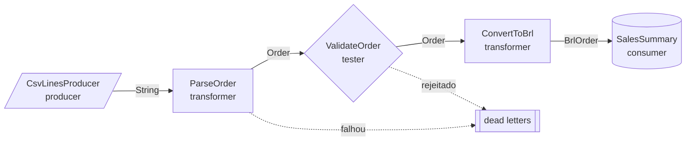

# Pipeline Architecture — ETL de arquivo de vendas

Implementação de referência do estilo **arquitetura em pipeline** (*pipes and filters*) do livro
*Fundamentos da Arquitetura de Software* (Richards & Ford), em **Java 21 puro** (sem framework; só JUnit/AssertJ nos testes).

## O problema

Todo dia a loja recebe um CSV de pedidos de vários países e moedas. É preciso: ler, interpretar cada linha, descartar
linhas inválidas (sem perder o rastro do motivo), converter tudo para BRL e gerar o faturamento por país.
É um fluxo **unidirecional, em etapas pequenas e independentes** — o encaixe natural do estilo.



Cada **filter** roda em sua própria *virtual thread*; cada **pipe** é uma fila limitada (`ArrayBlockingQueue`).
Etapas trabalham em paralelo em itens diferentes e uma etapa lenta aplica *back-pressure* nas anteriores.

## Documentação

| Documento | Conteúdo |
|-----------|----------|
| [01 — Conceito](docs/01-conceito.md) | Filters (producer, transformer, tester, consumer), pipes, topologia |
| [02 — Quando usar](docs/02-quando-usar.md) | Bons e maus casos de uso, comparação com outros estilos |
| [03 — Arquitetura da implementação](docs/03-arquitetura-da-implementacao.md) | Mapeamento livro → código, execução, tratamento de erros |
| [04 — Decisões e trade-offs](docs/04-decisoes-e-tradeoffs.md) | Escolhas de design, limitações e como evoluir |
| [05 — Características e testes](docs/05-caracteristicas-e-testes.md) | Avaliação das características de arquitetura e como validar |

## Estrutura

```
pipeline-architecture/
├── src/main/java/.../engine/   # o "framework": Producer, Transformer, Tester, Sink, Pipeline, DeadLetter
├── src/main/java/.../sales/    # o domínio: filtros de vendas, montagem do pipeline e CLI
├── src/main/resources/orders.csv   # amostra com linhas boas e ruins
└── docs/
```

## Como executar

Pré-requisitos: JDK 21+ e Maven 3.9+.

```bash
mvn verify                                   # testes
java -cp target/classes com.github.diovanibmotta.pipeline.sales.PipelineApplication            # amostra embutida
java -cp target/classes com.github.diovanibmotta.pipeline.sales.PipelineApplication meu.csv    # seu arquivo
```

Saída esperada com a amostra: 9 linhas lidas, 4 consumidas, 5 rejeitadas (com etapa e motivo), total R$ 820,00.

## Limitações (resumo)

Didático: pipeline **linear** e **em um só processo** (pipes em memória), sem persistência dos pipes nem reprocessamento.
Detalhes em [04 — Decisões e trade-offs](docs/04-decisoes-e-tradeoffs.md).
