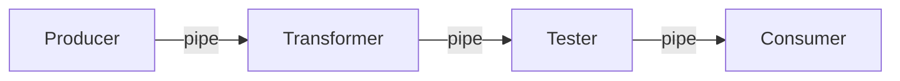

# 01 — Conceito

A arquitetura em pipeline (também *pipes and filters*) divide o processamento em **etapas independentes** ligadas por
**canais** de uma só direção. Inspira-se nos pipes do Unix: `cat orders.csv | parse | validate | convert | sum`.

## Componentes

| Componente | Papel | Regra | Neste projeto |
|------------|-------|-------|---------------|
| **Pipe** | Canal unidirecional, ponto a ponto, entre dois filters | Só transporta; não transforma | `ArrayBlockingQueue` limitada |
| **Producer** (source) | Início do fluxo | Só tem pipe de saída | `CsvLinesProducer` |
| **Transformer** | Recebe um dado, altera e repassa | 1 entrada → 1 saída | `ParseOrder`, `ConvertToBrl` |
| **Tester** | Testa um critério; repassa ou descarta | Não altera o dado | `ValidateOrder` |
| **Consumer** (sink) | Fim do fluxo | Só tem pipe de entrada | `SalesSummary` |

## Propriedades que definem o estilo

- **Cada filter faz uma coisa só**, sem conhecer os vizinhos; só sabe o tipo que entra e o que sai.
- **Filters são intercambiáveis e reordenáveis** (respeitando os tipos): trocar a conversão de moeda ou inserir um filtro de duplicados não toca nos demais.
- **Fluxo unidirecional**, sem estado compartilhado entre filters.
- **Concorrência natural**: filters diferentes processam itens diferentes ao mesmo tempo.

## Tipologia no livro

Topologia **monolítica** (um único quantum de implantação), partições **técnicas** (organizado por função de cada etapa,
não por domínio) e baixa evolutividade de domínio — ver [05](05-caracteristicas-e-testes.md).
