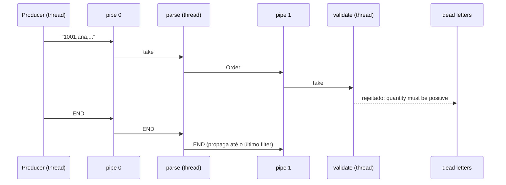

# 03 — Arquitetura da implementação

## Mapeamento livro → código

| Conceito | Código |
|----------|--------|
| Producer / Transformer / Tester / Consumer | `engine/Producer`, `Transformer`, `Tester`, `Sink` |
| Pipe | fila limitada (`ArrayBlockingQueue`) criada por `Pipeline.run()` entre cada par de filters |
| Montagem do pipeline | `Pipeline.from(...).transform(...).test(...).to(...)` (builder tipado) |
| Filters do domínio | `sales/ParseOrder`, `ValidateOrder`, `ConvertToBrl`, `SalesSummary` |
| Composição | `sales/SalesPipelines.salesReport(...)` |

O pacote `engine` não conhece vendas; o pacote `sales` não conhece threads nem filas.

## Execução

1. `run()` cria um pipe por filter e uma *virtual thread* por filter + uma para o producer.
2. Cada filter faz `take → trabalha → put` em loop até receber o marcador `END`, que ele repassa adiante e então termina.
3. `run()` só retorna quando todas as threads terminam; devolve `PipelineReport(produced, consumed, deadLetters)`.

## Tratamento de erros

| Falha | Comportamento |
|-------|---------------|
| Tester rejeita | Item vira `DeadLetter(stage, item, reason)`; fluxo segue |
| Transformer/Sink lança `RuntimeException` | Idem, com `e.toString()` como motivo |
| Producer lança exceção | `PipelineException` ao final: fonte quebrada não pode ser pulada. Itens já emitidos são processados |

## Back-pressure

Pipes têm capacidade (padrão 64, `pipeCapacity(n)`). Se um filter é lento, o pipe à frente do anterior enche e o `put`
bloqueia: a pressão sobe até o producer, que para de ler. Memória fica limitada, independente do tamanho do arquivo.
