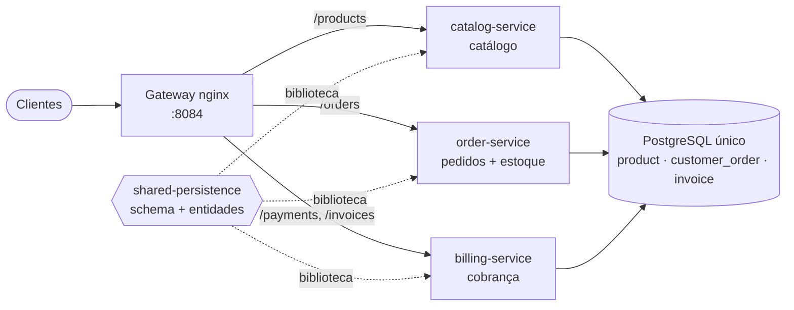

# Service-Based Architecture — Loja de eletrônicos

Implementação de referência do estilo **baseado em serviços** (*service-based architecture*) do livro
*Fundamentos da Arquitetura de Software* (Richards & Ford), em **Java 21 e Spring Boot**.

## O problema

Uma loja online de eletrônicos cresceu: catálogo, pedidos e cobrança têm ritmos de mudança e cargas diferentes
(a vitrine recebe 50× mais leituras que o checkout), e um monólito único já atrapalha — qualquer ajuste na cobrança
exige reimplantar tudo. Mas a equipe é pequena, o orçamento é limitado e **o estoque não pode ser vendido duas vezes**:
decompor em dezenas de microsserviços (com sagas e consistência eventual) seria caro demais.

## A ideia em um parágrafo

Dividir o sistema em **poucos serviços de domínio, de granularidade grossa** (3 a 12 é a faixa do livro), cada um
implantado separadamente, atrás de um **ponto de entrada único**, **compartilhando um único banco de dados**. Cada serviço
contém um domínio inteiro (por dentro pode ser em camadas) e executa seus casos de uso com **transações ACID locais**.
É o "meio-termo pragmático" entre o monólito e os microsserviços.



## Documentação

| Documento | Conteúdo |
|-----------|----------|
| [01 — Conceito](docs/01-conceito.md) | Serviços de domínio, banco compartilhado, API layer, granularidade |
| [02 — Quando usar](docs/02-quando-usar.md) | Critérios de decisão, bons e maus casos de uso, comparação com outros estilos |
| [03 — Arquitetura da implementação](docs/03-arquitetura-da-implementacao.md) | Mapeamento livro → código, sequências, topologia, API |
| [04 — Decisões e trade-offs](docs/04-decisoes-e-tradeoffs.md) | Escolhas de design, riscos do banco compartilhado, como evoluir |
| [05 — Características e testes](docs/05-caracteristicas-e-testes.md) | Avaliação das características de arquitetura e como validar cada uma |

## Estrutura

```
service-based-architecture/
├── shared-persistence/   # schema.sql + entidades/repositórios JPA compartilhados (o acoplamento, explícito)
├── catalog-service/      # domínio de catálogo: cadastro e consulta de produtos (:8081)
├── order-service/        # domínio de pedidos: reserva de estoque + criação do pedido numa transação (:8082)
├── billing-service/      # domínio de cobrança: pagamento e nota (invoice) (:8083)
├── nginx/nginx.conf      # gateway (API layer) por path
├── Dockerfile · docker-compose.yml
└── docs/
```

## Como executar

Pré-requisitos: JDK 21+, Maven 3.9+ (Docker opcional).

```bash
# testes (H2 em memória, inclui 40 compradores concorrentes disputando 5 unidades)
mvn verify

# topologia completa: 3 serviços + PostgreSQL único + gateway
docker compose up -d --build
```

```bash
# 1. cadastrar produto (5 unidades)
curl -s -X POST localhost:8084/products -H 'Content-Type: application/json' \
  -d '{"name":"Console","priceCents":300000,"stock":5}'

# 2. comprar (201 enquanto houver estoque, depois 409)
curl -s -X POST localhost:8084/orders -H 'Content-Type: application/json' -d '{"productId":1,"quantity":2}'

# 3. pagar o pedido (201; repetir devolve 409)
curl -s -X POST localhost:8084/payments -H 'Content-Type: application/json' -d '{"orderId":1}'
curl -s localhost:8084/invoices/1
```

### API (via gateway `:8084`)

| Serviço | Método | Rota | Descrição |
|---------|--------|------|-----------|
| catalog | `GET` | `/products`, `/products/{id}` | Consulta produtos · `404` se não existe |
| catalog | `POST` | `/products` | `{"name","priceCents","stock"}` → `201` |
| order | `POST` | `/orders` | `{"productId","quantity"}` (1 a 10) → `201` · `409` sem estoque · `404` produto desconhecido |
| order | `GET` | `/orders/{id}` | Pedido e status (`PENDING`/`PAID`) |
| billing | `POST` | `/payments` | `{"orderId"}` → `201` + nota · `409` já pago · `404` pedido desconhecido |
| billing | `GET` | `/invoices/{orderId}` | Nota fiscal do pedido |

### Experimentos sugeridos

```bash
# 1. Derrube a cobrança: catálogo e pedidos continuam atendendo (falha isolada por domínio)
docker compose stop billing-service

# 2. Escale só o que precisa (vitrine): 
docker compose up -d --scale catalog-service=3   # (ajuste o nginx para balancear)

# 3. Reimplante só um serviço sem tocar nos outros
docker compose up -d --build order-service
```

## Limitações (resumo)

Implementação **didática**. Atalhos conscientes em [04 — Decisões e trade-offs](docs/04-decisoes-e-tradeoffs.md):
sem autenticação, sem migração de schema versionada (Flyway), entidades compartilhadas em uma biblioteca comum
(mudar o schema obriga a recompilar/reimplantar todos os serviços), `nginx` simples no lugar de um API gateway completo.
