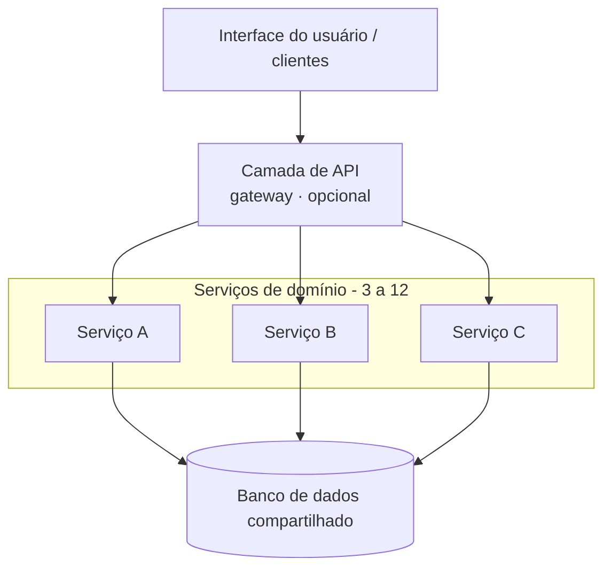

# 01 — Conceito

## O que é

A arquitetura **baseada em serviços** é um estilo **distribuído** híbrido: um conjunto pequeno de **serviços de domínio**
de **granularidade grossa**, implantados de forma independente, normalmente sobre **um único banco de dados compartilhado**.
É vista como a variação **pragmática** dos microsserviços: ganha boa parte da agilidade e da resiliência de um estilo
distribuído sem pagar toda a complexidade (orquestração, sagas, dados duplicados, dezenas de pipelines).

## Componentes

| Componente | Papel | Neste laboratório |
|------------|-------|-------------------|
| **Interface de usuário** | Um front-end único (ou um por domínio) | Qualquer cliente HTTP (`curl`) |
| **Camada de API** (opcional) | Ponto de entrada, roteamento, cross-cutting | `nginx` roteando por path |
| **Serviços de domínio** | Cada um implementa **um domínio inteiro** (e por dentro costuma ser em camadas) | `catalog`, `order`, `billing` |
| **Banco de dados compartilhado** | Uma instância (ou poucas) usada por todos os serviços | PostgreSQL único |

## Características que definem o estilo

- **Granularidade grossa**: um serviço = um *domínio* (pedidos), não uma função (calcular imposto).
- **Implantação independente**: cada serviço tem seu próprio ciclo de build/deploy/escala.
- **Banco compartilhado**: a maior diferença para microsserviços (onde cada serviço teria o seu).
  Traz **transações ACID locais** e joins, ao custo de **acoplamento pelo schema**.
- **Sem chamada entre serviços por padrão**: o ideal é que um caso de uso caiba em **um** serviço. Aqui,
  `billing-service` lê o pedido direto das tabelas compartilhadas em vez de chamar `order-service`.
- **Particionamento por domínio**: ao contrário de camadas, uma mudança de negócio costuma tocar um serviço só.

## Banco compartilhado: a fonte do bom e do ruim

| Bom | Ruim |
|-----|------|
| Transação ACID cobrindo estoque + pedido (sem saga) | Mudar uma tabela pode quebrar vários serviços |
| Joins e relatórios simples | Um banco é ponto único de falha e de contenção |
| Menos infraestrutura e menos código de integração | Dificulta times autônomos e escolhas tecnológicas por serviço |

**Mitigação clássica** (do livro): manter a **biblioteca de entidades/DAOs compartilhada** pequena e dividi-la por
**domínio** (tabelas de pedido, de catálogo…), de modo que cada mudança afete poucos serviços. Em produção, usar
**migrações versionadas** (Flyway/Liquibase) e testes de contrato do schema. Neste laboratório tudo está em
`shared-persistence` — deliberadamente simples, e discutido em [04](04-decisoes-e-tradeoffs.md).

## Variações

- **Um banco por domínio** (ou esquemas separados no mesmo servidor): mais isolamento, menos transação cruzada.
- **Várias UIs**, uma por domínio, em vez de uma única.
- **Serviços com arquitetura interna distinta** (um em camadas, outro com microkernel…): o estilo não impõe.
