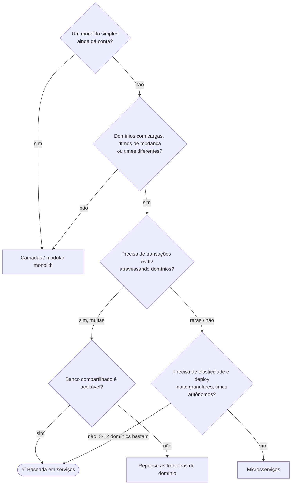

# 02 — Quando usar (e quando não usar)

## Resumo da decisão

Use baseada em serviços quando o sistema **já é grande demais para um monólito em camadas**, precisa de **implantação e
escala por domínio** e de **boa disponibilidade**, mas **não justifica** o custo e a complexidade dos microsserviços.

## Sinais de que o estilo é adequado

- Sistema com **3 a 12 domínios** claros (catálogo, pedidos, cobrança, estoque…).
- **Cargas desiguais**: dá para escalar só a vitrine, não o checkout.
- Equipe média, **orçamento limitado**, maturidade DevOps moderada.
- **Consistência forte** importa (estoque, saldo, faturamento) e o custo de sagas não compensa.
- Migração **incremental** a partir de um monólito: extrair um domínio de cada vez.

| Domínio | Por que encaixa |
|---------|-----------------|
| E-commerce de médio porte | Catálogo/pedidos/cobrança escalam e mudam em ritmos diferentes |
| Seguradoras, bancos (back-office) | Domínios estáveis e transações ACID relevantes |
| Modernização de legados | Quebrar o monólito em fatias grossas é viável e barato |

## Sinais de que o estilo **não** é adequado

| Sinal | Por quê | Estilo melhor |
|-------|---------|---------------|
| Dezenas/centenas de times, deploys contínuos por equipe | Banco e schema compartilhados viram gargalo organizacional | Microsserviços |
| Elasticidade extrema por função | Serviços grossos escalam "em blocos" | Microsserviços, space-based |
| Cada domínio precisa de tecnologia de dados própria | Banco único impõe uma só | Microsserviços |
| Aplicação simples, equipe de 3 pessoas | Distribuição é custo sem benefício | Camadas |
| Picos explosivos e imprevisíveis | Banco compartilhado no caminho crítico | Space-based |

## Comparação com os demais estilos do laboratório

| Critério | Camadas | **Baseada em serviços** | Space-based |
|----------|---------|-------------------------|-------------|
| Particionamento | Técnico | **Domínio** | Domínio |
| Implantação | 1 unidade | **Por serviço** | Por unidade de processamento |
| Banco | Único | **Compartilhado** | Grid em memória + banco assíncrono |
| Consistência entre domínios | ACID | **ACID (mesmo banco)** | Eventual |
| Custo | $ | **$$** | $$$$ |
| Simplicidade | ★★★★★ | **★★★☆** | ★ |
| Escalabilidade | ★ | **★★★** | ★★★★★ |
