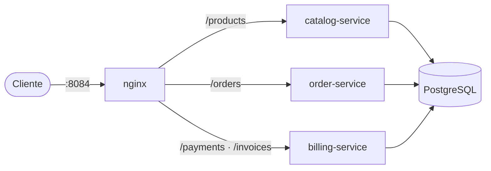
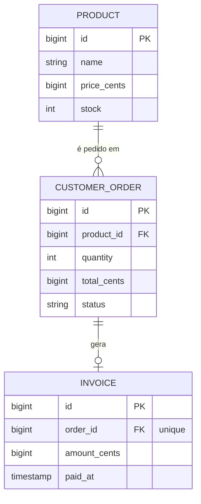
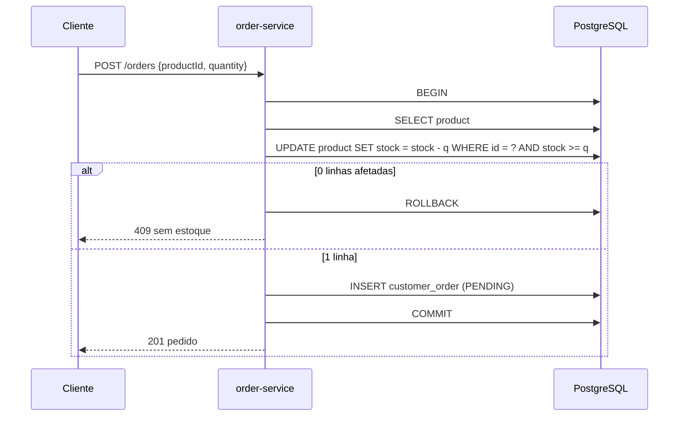
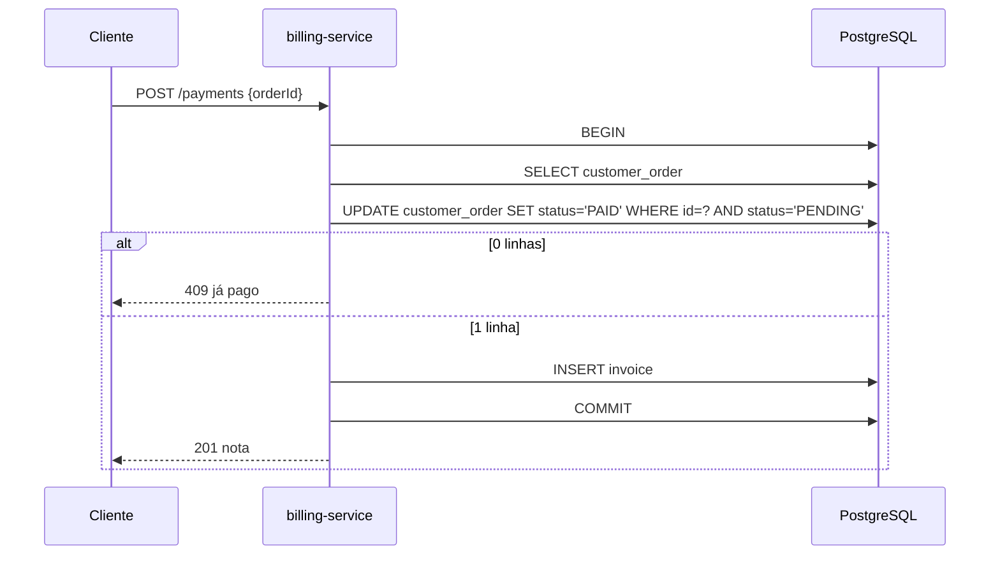

# 03 — Arquitetura da implementação

## Mapeamento livro → código

| Conceito do livro | Implementação |
|-------------------|---------------|
| Serviço de domínio | `catalog-service`, `order-service`, `billing-service` (cada um um Spring Boot, um `.jar`, um container) |
| Banco de dados compartilhado | PostgreSQL único (`shop`); H2 em memória nos testes |
| Biblioteca compartilhada de persistência | `shared-persistence`: `schema.sql`, entidades JPA, repositórios, exceções HTTP |
| Camada de API | `nginx/nginx.conf` (roteamento por path) |
| Implantação independente | `Dockerfile` parametrizado por `MODULE`; um container por serviço |

## Topologia

Cada serviço **não conhece** os outros: não há chamadas HTTP entre eles. O que os liga é o schema.

## Modelo de dados compartilhado

| Tabela | Dono (escreve) | Lê |
|--------|----------------|----|
| `product` | catalog (cadastro) · order (decrementa estoque) | todos |
| `customer_order` | order (cria) · billing (marca `PAID`) | todos |
| `invoice` | billing | billing |

> Note que **duas tabelas têm mais de um escritor**. É o preço do banco compartilhado, discutido em [04](04-decisoes-e-tradeoffs.md).

## Sequência: fazer um pedido (um serviço, uma transação)

O `UPDATE ... WHERE stock >= q` é **atômico**: o banco serializa compradores concorrentes do último item. Estoque e pedido
mudam juntos ou não mudam — **sem saga**, graças ao banco compartilhado.

## Sequência: pagar (outro serviço, mesma garantia)

`billing-service` **lê o pedido direto do banco** em vez de chamar `order-service`: nenhuma dependência de runtime entre
serviços, então a queda de um não derruba o outro.

## Estrutura interna de cada serviço

Cada serviço é pequeno e plano (controller + service). Em um domínio maior, **por dentro** ele seria em camadas
(ver [layered-architecture](../../layered-architecture)) — o estilo não prescreve a arquitetura interna.

## API

Ver tabela no [README](../README.md#api-via-gateway-8084). Erros: `404` não encontrado, `409` conflito de negócio
(sem estoque, já pago), `400` validação.
