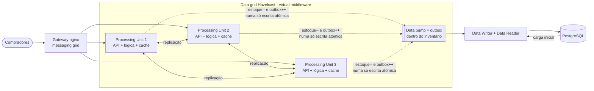

# Space-Based Architecture — Venda relâmpago de ingressos

Implementação de referência do estilo **arquitetura baseada em espaço** (*space-based architecture*) do livro
*Fundamentos da Arquitetura de Software* (Richards & Ford), usando **Java 21, Spring Boot e Hazelcast**
(um dos *data grids* citados no livro, ao lado de Apache Ignite e Oracle Coherence).

## O problema

Um show muito aguardado abre a venda de **1.000 ingressos** e milhares de pessoas clicam em "comprar" no mesmo segundo.
O tráfego é **imprevisível e explosivo** (de ~0 a dezenas de milhares de req/s em segundos), e a regra de negócio é
estrita: **nunca vender o mesmo assento duas vezes**. Um banco de dados relacional no caminho de cada requisição vira o
gargalo (conexões esgotadas, locks de linha, timeouts) — exatamente o cenário para o qual o estilo foi criado.

## A ideia em um parágrafo

Em vez de escalar o banco, **remove-se o banco do caminho crítico**. O estado "quente" (estoque de assentos) vive em
**memória**, em um *data grid* distribuído, dentro de cada **unidade de processamento** (*processing unit*). Uma requisição
é atendida inteiramente em memória; a persistência acontece **depois, de forma assíncrona**, por uma *data pump* que
alimenta um *data writer*. Para absorver picos, basta subir mais unidades de processamento.



## Documentação

| Documento | Conteúdo |
|-----------|----------|
| [01 — Conceito](docs/01-conceito.md) | Componentes do estilo, *virtual middleware*, tipos de cache, data pump, data writer/reader |
| [02 — Quando usar](docs/02-quando-usar.md) | Critérios de decisão, bons e maus casos de uso, comparação com outros estilos |
| [03 — Arquitetura da implementação](docs/03-arquitetura-da-implementacao.md) | Mapeamento livro → código, diagramas de sequência, topologia, API |
| [04 — Decisões e trade-offs](docs/04-decisoes-e-tradeoffs.md) | Escolhas de design, riscos, limitações conhecidas e como evoluir |
| [05 — Características e testes](docs/05-caracteristicas-e-testes.md) | Avaliação das características de arquitetura e como validar cada uma |

## Estrutura

```
space-based-architecture/
├── ticketing-contracts/          # objetos compartilhados pelo grid (EventInventory, ReservationConfirmed)
├── ticketing-processing-unit/    # unidade de processamento: API REST + lógica + membro embutido do Hazelcast
├── ticketing-data-writer/        # data writer + data reader: drena a data pump para o PostgreSQL e recarrega o grid
├── nginx/nginx.conf              # gateway (messaging grid simplificado)
├── docker-compose.yml            # 3 unidades de processamento + writer + postgres + gateway
├── scripts/flash-sale.sh         # simulação da venda relâmpago
└── docs/
```

## Como executar

Pré-requisitos: JDK 21+, Maven 3.9+, Docker.

```bash
# testes (sobem 2 membros reais do grid na mesma JVM e atacam com 400 compradores concorrentes)
mvn verify

# topologia completa
docker compose up -d --build

# 1.500 compradores simultâneos disputando 1.000 ingressos
scripts/flash-sale.sh 1500 100
```

Resultado esperado: exatamente **1.000 respostas `201`** e **500 respostas `409`** (esgotado), requisições distribuídas
entre `pu-1`, `pu-2` e `pu-3`, estoque final `0` — e, segundos depois, o PostgreSQL com as 1.000 reservas
(a *data pump* esvazia o backlog em segundo plano).

### API

| Método | Rota | Descrição |
|--------|------|-----------|
| `GET` | `/events/{eventId}/availability` | Estoque atual (lido da memória) |
| `POST` | `/events/{eventId}/reservations` | Corpo `{"customerId":"ana","quantity":2}` (1 a 4). `201` reservado · `409` esgotado · `404` evento desconhecido |
| `GET` | `/grid` | Membros do cluster e tamanho do backlog da data pump |

O header `X-Served-By` indica qual unidade de processamento atendeu a requisição.

### Experimentos sugeridos

```bash
# 1. Derrube uma unidade no meio da venda: nada se perde, nginx redireciona
docker compose stop pu-2

# 2. Pare o data writer: a venda continua; o backlog cresce em GET /grid e é drenado quando ele volta
docker compose stop data-writer && docker compose start data-writer

# 3. Escale a capacidade: adicione pu-4 ao compose (e ao GRID_MEMBERS / nginx.conf) e repita o flash-sale
```

## Limitações (resumo)

É uma implementação **didática**. Os principais atalhos conscientes estão em [04 — Decisões e trade-offs](docs/04-decisoes-e-tradeoffs.md):
discovery estático (TCP/IP) em vez de dinâmico, *data pump* sem persistência própria, `nginx` no lugar de um *messaging grid* completo,
ausência de *processing grid* e de *deployment manager* automático.
