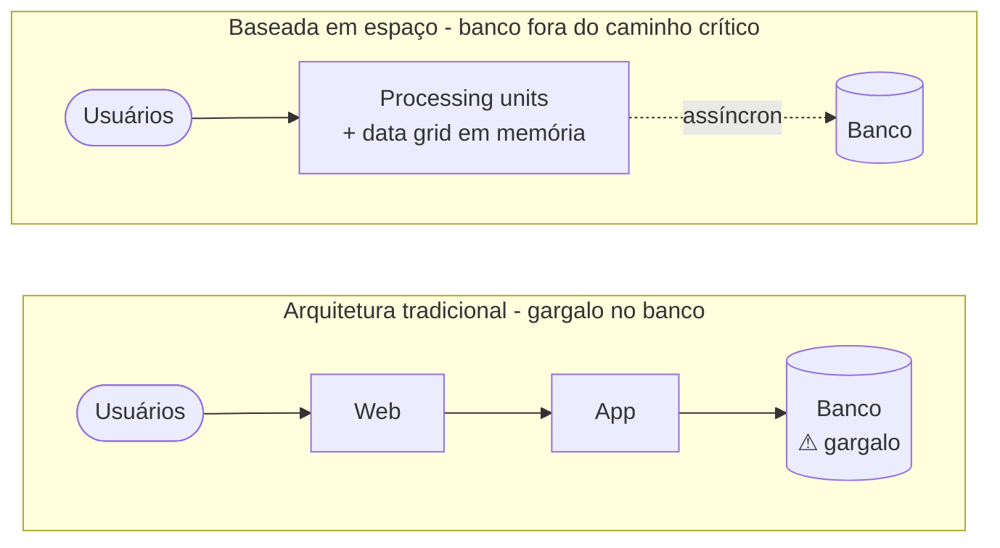
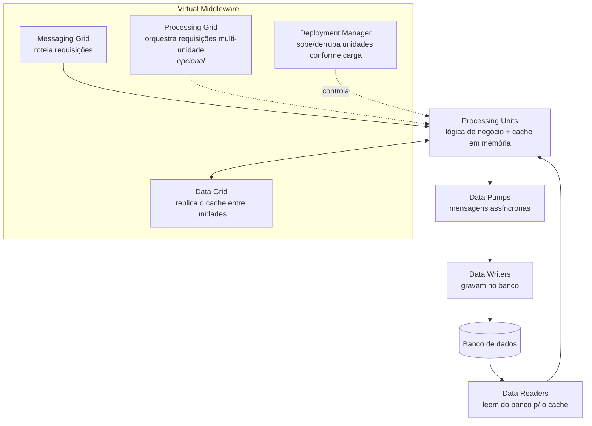
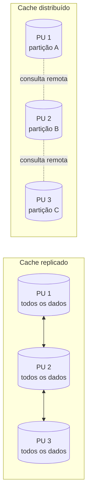
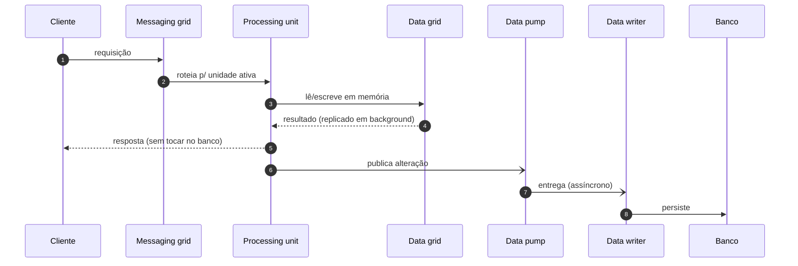

# 01 — Conceito: arquitetura baseada em espaço

## Origem do nome

O estilo vem do conceito de **tuple space** (espaço de tuplas): uma memória compartilhada distribuída onde vários processos
leem e escrevem dados sem se falarem diretamente. Na prática moderna, o "espaço" é um **data grid em memória**
(Hazelcast, Apache Ignite, Oracle Coherence, GigaSpaces...).

## O problema que o estilo ataca

Em aplicações web tradicionais (navegador → servidor web → servidor de aplicação → banco) cada camada escala de forma diferente,
e o **banco de dados é o último e mais caro gargalo a escalar**. Quando o volume de usuários concorrentes cresce muito e de forma
imprevisível, adicionar servidores web/aplicação só empurra a fila para o banco.

A solução: **eliminar o banco como ponto de sincronização** das requisições. Os dados vivem em memória (replicada) dentro das
próprias unidades de processamento, e o banco passa a ser apenas um **armazenamento durável atualizado depois**.

## Componentes do estilo

| Componente | Responsabilidade | Nesta implementação |
|------------|------------------|---------------------|
| **Processing unit** | Executa a lógica de negócio (web + regras) e contém o cache em memória. Pode ser pequena (um serviço) ou grande (uma aplicação inteira). | `ticketing-processing-unit` (Spring Boot + membro Hazelcast embutido) |
| **Virtual middleware** | Infraestrutura que mantém as unidades coordenadas. Subdivide-se em quatro partes (abaixo). | Hazelcast + nginx + Docker Compose |
| ↳ **Messaging grid** | Recebe a requisição e decide *qual unidade ativa* a atende (balanceamento / roteamento). | `nginx` (`least_conn`) |
| ↳ **Data grid** | Replica o estado entre todas as unidades; é o componente mais importante. Em cada unidade, o dado parece local. | `IMap` do Hazelcast com 2 backups síncronos |
| ↳ **Processing grid** | Opcional. Orquestra requisições que envolvem **várias** unidades de tipos diferentes (ex.: pedido + pagamento). | **Não implementado** (não necessário aqui) |
| ↳ **Deployment manager** | Inicia e encerra unidades de processamento conforme a carga (elasticidade). | Manual: `docker compose` / adicionar `pu-N` |
| **Data pump** | Envia dados **assincronamente** do cache para o armazenamento durável (e o contrário). Normalmente via mensageria. | `IQueue` do Hazelcast |
| **Data writer** | Consome a data pump e grava no banco. | `DataPumpConsumer` + `ReservationRepository` |
| **Data reader** | Lê do banco e coloca no cache (partida a frio, falha total do grid). | `InventoryLoader` |

## Tipos de cache: replicado × distribuído

O livro destaca duas topologias de dados, com um *trade-off* claro:

| | Replicado | Distribuído |
|---|-----------|-------------|
| Leitura | Local, ultrarrápida | Pode exigir chamada remota |
| Tolerância a falhas | Alta (todos têm tudo) | Menor (depende de backups da partição) |
| Consistência | Mais complexa (sincronizar N cópias) | Mais simples (um dono por chave) |
| Tamanho do cache | Limitado pela memória de **uma** unidade | Cresce com o nº de unidades |
| Indicado para | Dados pequenos/médios, muita leitura, alta disponibilidade | Dados grandes |

**Escolha desta implementação:** o inventário é pequeno e o requisito é disponibilidade, então usamos o comportamento
**replicado** — porém com um detalhe importante explicado em [04](04-decisoes-e-tradeoffs.md#d1): o `IMap` do Hazelcast é
particionado com *N backups*; com `backups = nº de unidades − 1` cada unidade guarda **uma cópia completa**, mas cada chave
continua tendo **um único dono** que serializa as escritas. Assim temos a leitura local do replicado **sem** perder atomicidade.

## Fluxo geral de uma requisição

O ponto central: a resposta ao cliente (passo 5) **não espera** o banco (passos 7–8).

## Em uma frase

> Baseada em espaço = **processar e guardar o estado quente em memória replicada nas próprias unidades de processamento**,
> persistindo no banco de forma assíncrona, para obter elasticidade e escalabilidade extremas sob carga imprevisível.
