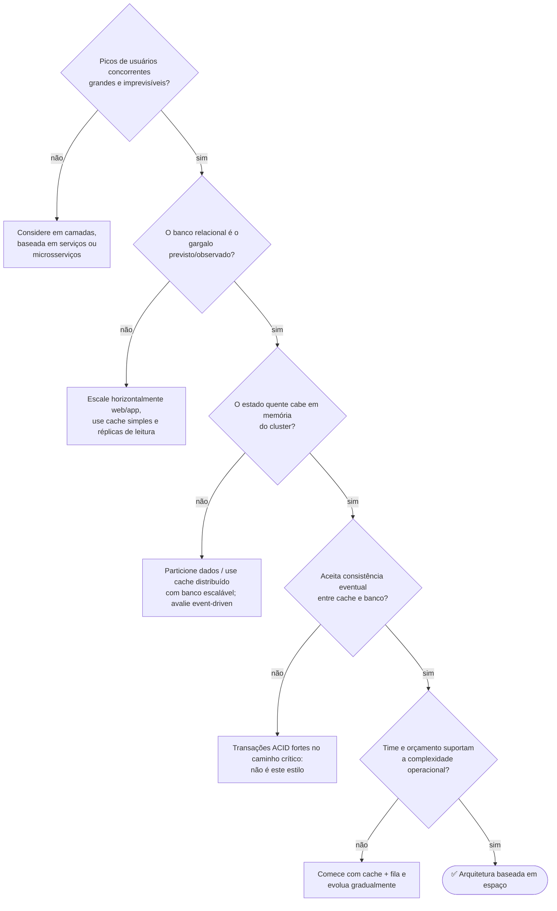

# 02 — Quando usar (e quando não usar)

## Resumo da decisão

Use arquitetura baseada em espaço quando **a escalabilidade e a elasticidade sob carga concorrente imprevisível são o
requisito dominante** e o custo/complexidade extra se justificam. Se o problema é de outra natureza, outros estilos serão
melhores — este é um estilo **especializado**, não um padrão geral.

## Sinais de que o estilo é adequado

- **Carga explosiva e imprevisível**: lançamentos, vendas relâmpago, venda de ingressos, leilões online, abertura de
  inscrições, eventos ao vivo, *drops* de produtos limitados.
- **Muitos usuários concorrentes** disputando **os mesmos dados** (contenção alta).
- Latência baixa é requisito de negócio (milissegundos).
- O **conjunto de dados "quente" é relativamente pequeno** (estoque, sessões, lances, cotações) e cabe em memória.
- O negócio tolera que a **persistência durável ocorra segundos depois** (consistência eventual entre grid e banco).
- Elasticidade real é necessária: subir/derrubar unidades em minutos conforme a demanda.

### Exemplos clássicos (livro e mercado)

| Domínio | Por que encaixa |
|---------|-----------------|
| Venda de ingressos (show, cinema, estádio) | Pico instantâneo, disputa por poucos recursos, "esgotado" tem que ser exato |
| Leilões online | Muitos lances simultâneos sobre o mesmo item, latência crítica |
| Flash sales / Black Friday | Estoque limitado, tráfego 100× o normal em segundos |
| Apostas ao vivo, cotações, *order books* | Estado em memória, atualização contínua |
| Sessões / carrinhos em larga escala | Dado efêmero, leitura/escrita intensas |

### Por que **venda de ingressos** foi o caso escolhido aqui

1. Tem **os três sintomas** do estilo ao mesmo tempo: pico súbito, contenção sobre poucas linhas (assentos) e requisito de
   corretude ("não vender duas vezes").
2. O inventário é minúsculo (cabe em KBs) mas é lido/escrito milhares de vezes por segundo — o par ideal para memória.
3. Persistir a reserva **depois** é aceitável: o cliente só precisa saber *agora* se garantiu o assento.
4. Permite demonstrar com testes objetivos: nenhum *overselling*, queda de unidade sem perda, e backlog assíncrono.

## Quando **não** usar

| Situação | Por quê |
|----------|---------|
| Sistema de **banco de dados tradicional / transacional** (ERP, financeiro, contábil) com grandes volumes de dados | O estilo não serve para grandes bases relacionais com transações ACID entre muitas entidades; o *working set* não cabe em memória |
| Carga **previsível e estável** | Elasticidade extrema é custo sem retorno; uma arquitetura em camadas escalada verticalmente resolve |
| Exige **consistência forte imediata** entre cache e banco, ou leituras sempre atuais do banco | A data pump é assíncrona: existe janela de inconsistência |
| Dados **grandes demais** para memória (histórico, analytics, blobs) | Cache distribuído sobre grandes volumes perde as vantagens |
| Equipe pequena / sem experiência em sistemas distribuídos | Complexidade operacional e de teste alta (ver abaixo) |
| Orçamento restrito | Memória, licenças (grids comerciais), múltiplos ambientes e testes de carga são caros |
| Relatórios e consultas ad hoc intensas sobre o dado | O grid é ruim para consultas complexas; faça no banco/*data warehouse* |

> O livro enfatiza: o estilo é bom para **partes** de um sistema. É comum **combiná-lo** com outro estilo — por exemplo,
> só o *checkout*/estoque em espaço, enquanto o restante (cadastro, relatórios) continua em camadas ou serviços.

## Custos e riscos que você assume

- **Complexidade**: concorrência, replicação, partição de rede, *split-brain*, ordem de eventos.
- **Testabilidade baixa**: simular pico real (milhares de usuários) em ambiente de teste é difícil e caro (o livro cita isso explicitamente).
- **Perda de dados na janela assíncrona**: se todo o grid cair antes da data pump drenar, reservas confirmadas podem se perder (ver [04](04-decisoes-e-tradeoffs.md)).
- **Colisões de dados**: se um dado é atualizado em várias unidades ao mesmo tempo, é preciso definir quem "ganha" (aqui: dono único por chave + *entry processor*).
- **Custo**: muita RAM replicada; infraestrutura de middleware.

## Comparação rápida com outros estilos do livro

| Critério | Baseada em espaço | Em camadas | Baseada em serviços | Microsserviços | Orientada a eventos |
|----------|:-:|:-:|:-:|:-:|:-:|
| Elasticidade | ★★★★★ | ★ | ★★ | ★★★★★ | ★★★ |
| Escalabilidade | ★★★★★ | ★ | ★★★ | ★★★★★ | ★★★★★ |
| Desempenho (latência) | ★★★★★ | ★★★ | ★★★ | ★★ | ★★★★★ |
| Simplicidade | ★ | ★★★★★ | ★★★ | ★ | ★ |
| Testabilidade | ★ | ★★ | ★★★★ | ★★★★★ | ★★ |
| Custo | $$$$ | $ | $$ | $$$$$ | $$$ |

*Valores aproximados, a partir das tabelas de características do livro; confira a sua edição para os números exatos.*

## Checklist antes de adotar

- [ ] Medi (ou tenho forte evidência) de que o banco é o gargalo sob pico?
- [ ] O estado quente cabe em memória, com folga, mesmo replicado?
- [ ] O negócio aceita a janela de consistência eventual com o banco?
- [ ] Definimos o que acontece se o grid inteiro cair (RPO/RTO)?
- [ ] Temos como **testar carga** em escala próxima da real?
- [ ] O time sabe operar um data grid (monitoramento, *split-brain*, upgrades)?

Se a maioria for "não", comece mais simples (cache + fila + escala horizontal do banco) e **evolua** para este estilo apenas quando os números exigirem.
