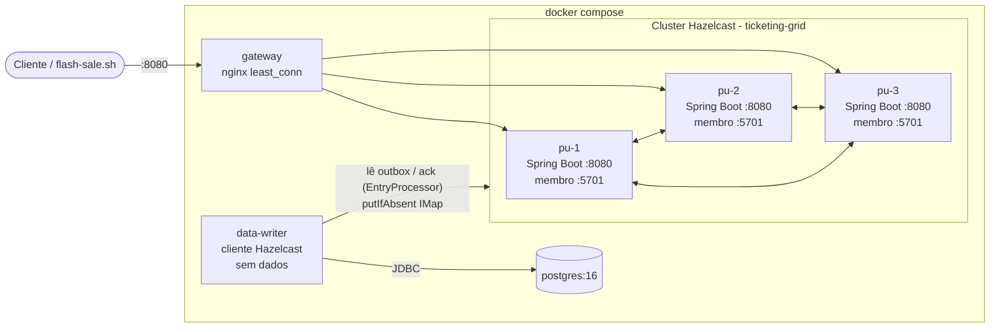
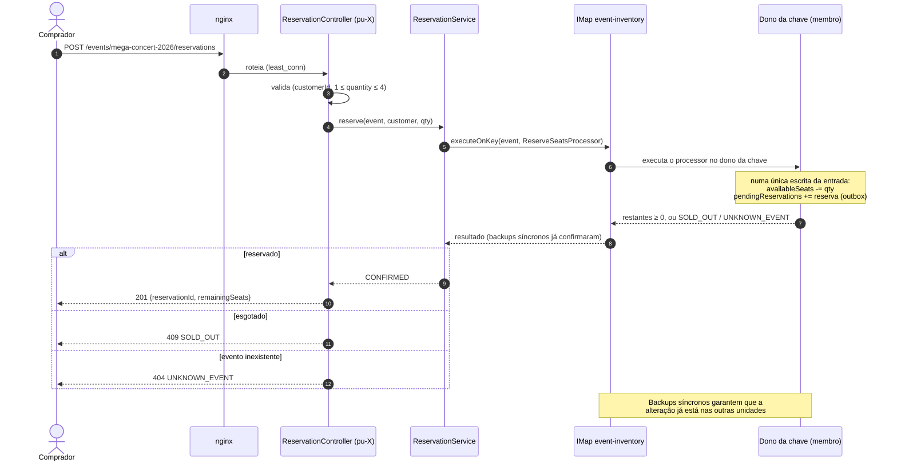
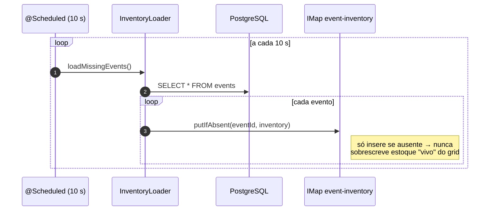
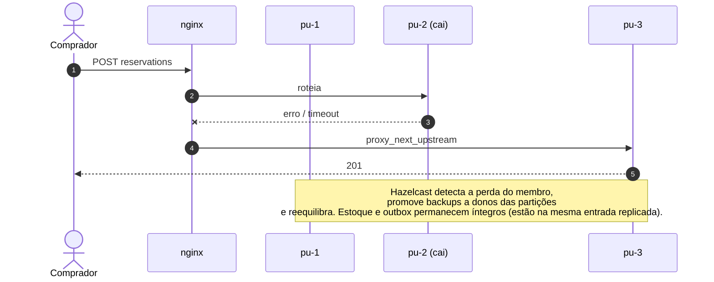
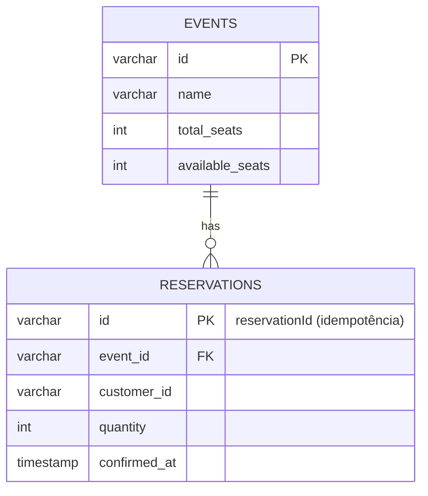

# 03 — Arquitetura da implementação

## Visão de implantação



- As **3 unidades de processamento** são idênticas e simétricas; todas são membros do cluster e guardam o inventário completo.
- O **data writer** é *cliente* do cluster (não é membro): não armazena partições, só conversa com o grid. Isso o isola do
  ciclo de vida dos dados e permite reiniciá-lo sem rebalanceamento.
- O **banco nunca é acessado pelas unidades de processamento.** Só o data writer fala com o PostgreSQL.

## Mapeamento livro → código

| Conceito do livro | Classe / artefato |
|-------------------|-------------------|
| Processing unit | [`ticketing-processing-unit`](../ticketing-processing-unit) — `ReservationController` (web) + `ReservationService` (negócio) + membro Hazelcast |
| Data grid (cache replicado) | `IMap<String, EventInventory>` configurada em `GridConfigFactory` (`backupCount` síncrono) |
| Operação atômica no grid | `ReserveSeatsProcessor` (*entry processor*) |
| Data pump | *Outbox* `EventInventory.pendingReservations` (mesma entrada do estoque) + `AcknowledgeProcessor` |
| Data writer | `DataPumpConsumer` + `ReservationRepository` em [`ticketing-data-writer`](../ticketing-data-writer) |
| Data reader | `InventoryLoader` (`putIfAbsent` periódico do banco para o grid) |
| Messaging grid | `nginx/nginx.conf` |
| Deployment manager | `docker-compose.yml` (manual) |
| Contratos compartilhados | [`ticketing-contracts`](../ticketing-contracts) |

## Fluxo 1 — Reserva de ingressos (caminho crítico)



Nenhuma etapa envolve I/O de banco. O custo é: validação + um salto de rede ao dono da chave (se ele não for a unidade
local) + replicação síncrona para os backups.

**Por que o outbox fica dentro do inventário?** Estoque e reserva pendente são gravados na **mesma entrada** do mapa, logo na
mesma operação atômica e replicada. Não existe janela em que o assento foi vendido mas a reserva ainda não está registrada para
persistência (o que ocorreria com duas operações separadas, ex.: `IMap` + `IQueue`, se a unidade caísse entre elas).

## Fluxo 2 — Persistência assíncrona (outbox → data writer)

```mermaid
sequenceDiagram
    autonumber
    participant G as IMap event-inventory (grid)
    participant W as DataPumpConsumer
    participant R as ReservationRepository
    participant DB as PostgreSQL

    loop enquanto rodando
        W->>G: get(eventId) → pendingReservations
        alt outbox vazio
            W->>W: sleep 50 ms
        else há reservas pendentes
            loop cada reserva
                W->>R: save(reservation)
                R->>DB: BEGIN
                R->>DB: INSERT reservations (PK = reservationId)
                alt chave duplicada (replay)
                    DB-->>R: DuplicateKeyException
                    R-->>W: false (ignorado)
                else novo
                    R->>DB: UPDATE events SET available_seats = available_seats - qty
                    R->>DB: COMMIT
                    R-->>W: true
                end
            end
            W->>G: executeOnKey(eventId, AcknowledgeProcessor(ids))
            Note over G: remove do outbox só os ids já gravados;<br/>reservas que chegaram durante a gravação permanecem
        end
    end
```

**Garantia:** *at-least-once*. A ordem é **ler → gravar no banco → confirmar no grid**. Se o writer cair entre gravar e
confirmar, as reservas são relidas e reenviadas — e o `INSERT` com chave primária `reservationId` torna o reprocessamento
**idempotente**. O *ack* remove por id, nunca "tudo", então não perde reservas que entraram enquanto o writer gravava.

## Fluxo 3 — Carga/recarga do grid (data reader)



Cobre dois cenários: **partida a frio** (o banco semeia o grid vazio) e **falha total do grid** (ao voltar, o grid é
repovoado a partir do último estado durável).

## Fluxo 4 — Falha de uma unidade



## Modelo de dados



No grid, a mesma informação vive como `EventInventory(eventId, name, totalSeats, availableSeats)`. A **fonte da verdade durante a
venda é o grid**; o banco é uma cópia durável que converge após o backlog da data pump zerar.

## API

| Método | Rota | Sucesso | Erros |
|--------|------|---------|-------|
| `GET` | `/events/{eventId}/availability` | `200` `EventInventory` | `404` |
| `POST` | `/events/{eventId}/reservations` | `201` `{reservationId, quantity, remainingSeats}` | `400` validação · `404` evento · `409` esgotado |
| `GET` | `/grid` | `200` `{node, members[], dataPumpBacklog}` | — |
| `GET` | `/actuator/health` | `200` | — |

Todas as respostas dos endpoints de evento trazem `X-Served-By: pu-N`.

## Configuração relevante

| Variável | Onde | Efeito |
|----------|------|--------|
| `GRID_MEMBERS` | PU e writer | Endereços `host:porta` das unidades (discovery TCP/IP) |
| `GRID_BACKUPS` | PU | Nº de cópias síncronas. `3 unidades → 2` = cópia completa em todas |
| `NODE_NAME` | PU | Nome devolvido em `X-Served-By` |
| `SPRING_DATASOURCE_*` | writer | Conexão com o PostgreSQL |

## Como estender (adicionar `pu-4`)

1. Duplicar o serviço `pu-3` no `docker-compose.yml` como `pu-4`.
2. Incluir `pu-4:5701` em `GRID_MEMBERS` (em todas as unidades e no writer).
3. Incluir `server pu-4:8080;` no `upstream` do `nginx.conf`.
4. `docker compose up -d --build` — o novo membro entra no cluster e recebe cópia dos dados.
