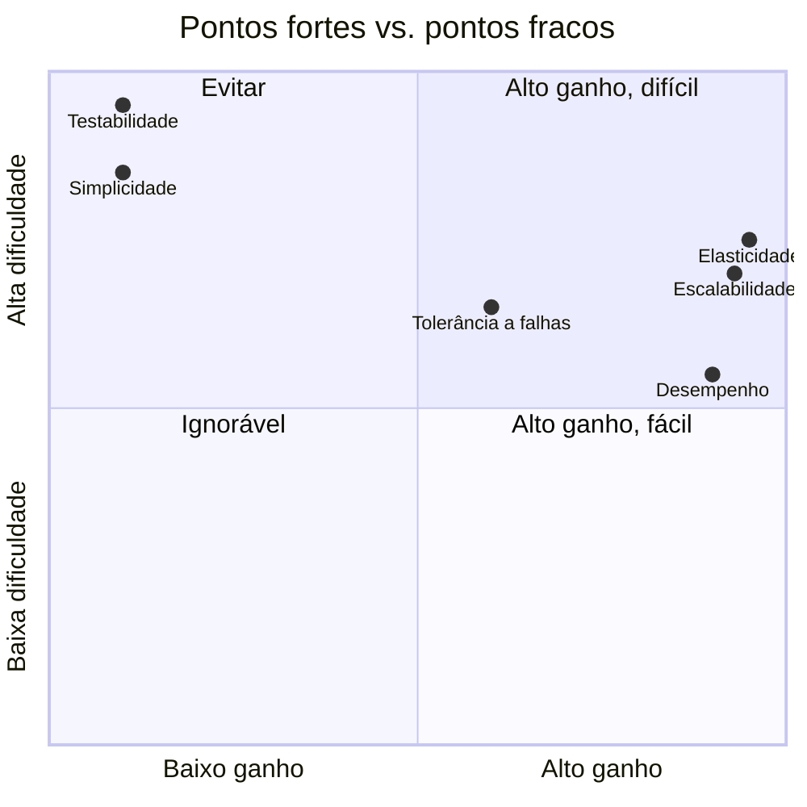
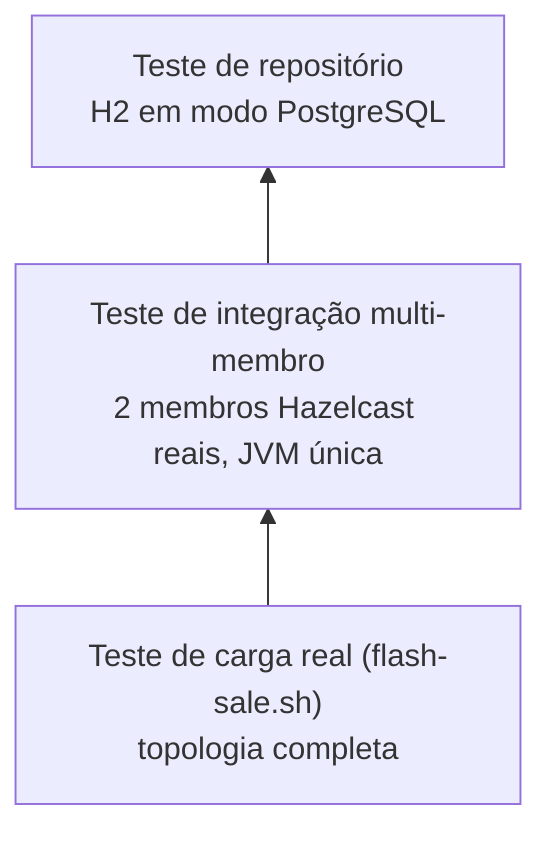

# 05 — Características de arquitetura e como testar

## Avaliação do estilo (tabela do livro, resumida)

| Característica | Nota | Por quê |
|----------------|:----:|---------|
| Elasticidade | ★★★★★ | Unidades sobem/descem rapidamente; sem banco no caminho crítico |
| Escalabilidade | ★★★★★ | Capacidade cresce com o nº de unidades (até o limite da replicação) |
| Desempenho | ★★★★★ | Tudo em memória; resposta sem I/O de banco |
| Tolerância a falhas | ★★★ | Replicação protege contra perda de unidades; falha total do grid perde backlog |
| Implantabilidade | ★★ | Muitas partes móveis, middleware, configuração de cluster |
| Evolutividade | ★★ | Mudança de modelo de dados exige migrar grid + banco |
| Simplicidade | ★ | Concorrência, replicação, consistência eventual |
| Testabilidade | ★ | Reproduzir pico real é difícil e caro |
| Custo geral | $$$$ | RAM replicada, infraestrutura, observabilidade, testes de carga |

*Valores aproximados, conforme as tabelas do livro; confira a sua edição.*



## Estratégia de testes deste projeto

| Camada | O que valida | Onde |
|--------|--------------|------|
| **Concorrência / corretude** | 400 compradores × 100 assentos distribuídos entre 2 unidades → exatamente 100 reservas, estoque 0, 100 reservas no outbox | `ReservationGridTest#neverOversellsUnderConcurrentLoadSpreadAcrossUnits` |
| **Tolerância a falhas** | Derrubar uma unidade preserva estoque e outbox | `ReservationGridTest#survivesLossOfOneUnitWithoutLosingInventory` |
| **Regras de borda** | Evento desconhecido e esgotado | `ReservationGridTest#rejectsUnknownEventAndSoldOut` |
| **Atomicidade do outbox** | Reservar decrementa estoque e entra no outbox de uma vez; ack remove só os ids gravados | `EventInventoryTest` |
| **Persistência idempotente** | Reserva reprocessada não decrementa duas vezes | `ReservationRepositoryTest#replayedMessageIsIgnored` |
| **Data writer** | Drena outbox → banco → ack; replay após queda entre commit e ack não duplica | `DataPumpConsumerTest` (membro Hazelcast real + H2) |
| **Ponta a ponta** | 1.500 compradores → 1.000×`201`, 500×`409`, banco com 1.000 reservas | `scripts/flash-sale.sh` |



Os testes de integração sobem **membros reais do Hazelcast** (não mocks) — num estilo cuja essência é o comportamento do
grid, mockar o grid esconderia exatamente os bugs que importam.

### Executando

```bash
mvn verify                      # todos os testes automatizados
docker compose up -d --build    # topologia completa
scripts/flash-sale.sh 1500 100  # 1500 compradores, 100 em paralelo
```

## Validação executada na criação deste repositório

- `mvn verify`: 9 testes passando (2 de domínio, 3 de grid, 2 de repositório, 2 do data writer).
- Execução ponta a ponta local (2 unidades de processamento + data writer + banco H2): 1.200 requisições concorrentes alternadas entre as 2 unidades →
  **1.000 × `201`, 200 × `409`**, estoque final `0`, backlog da pump `0`, **1.000 linhas** em `reservations` somando 1.000 assentos.
- A topologia `docker compose` (3 unidades + nginx + PostgreSQL) foi escrita mas **não pôde ser executada no ambiente de criação**
  (o Docker não estava disponível). Valide-a localmente com os comandos acima.

## Como medir as características na prática

| Característica | Como medir | Ferramenta sugerida |
|----------------|-----------|---------------------|
| Desempenho | p50/p95/p99 de `POST /reservations` sob carga | k6, Gatling, JMeter |
| Escalabilidade | Throughput × nº de unidades (1, 2, 3, 4...) | k6 + `docker compose` |
| Elasticidade | Tempo para absorver pico ao adicionar unidades | Orquestrador com *autoscaling* |
| Tolerância a falhas | Matar unidades durante a carga (*chaos*) | `docker compose stop`, Toxiproxy |
| Convergência assíncrona | `dataPumpBacklog` ao longo do tempo; tempo até zerar | `GET /grid` |
| Corretude | `201` ≤ assentos; `sum(quantity)` no banco = assentos vendidos | `flash-sale.sh` + SQL |
